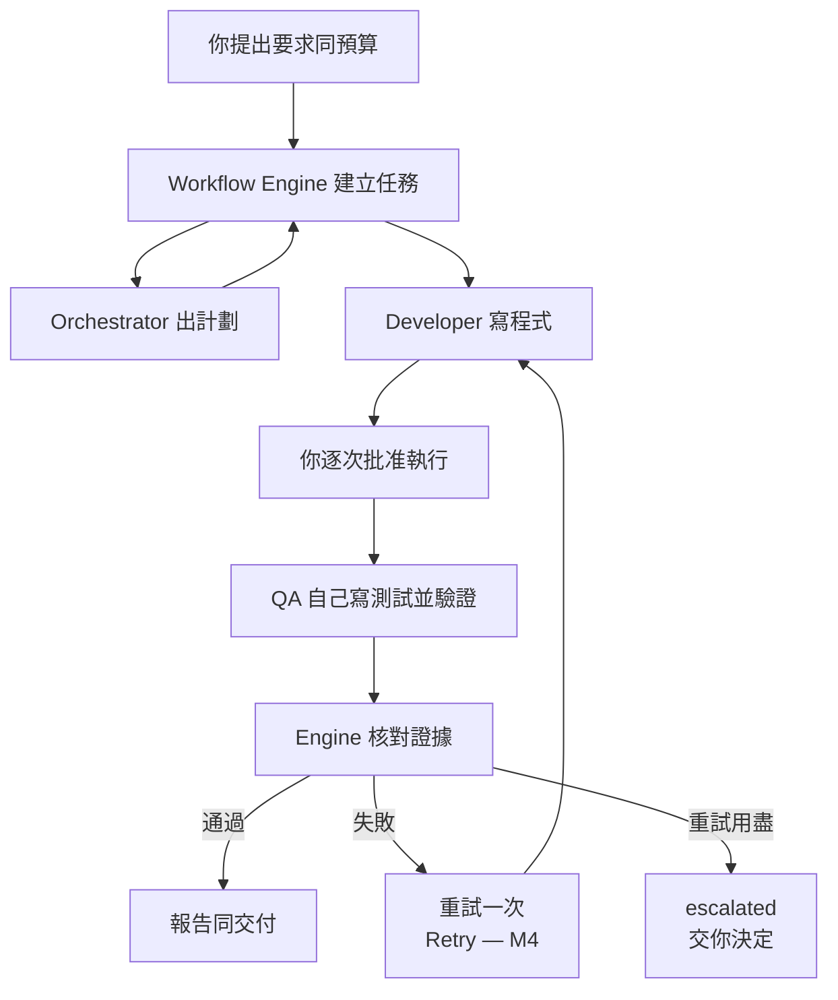

# AI Engineering Team

一個「個人 AI 工程團隊」嘅設計同實作起點。目標唔係做另一個 AI 編程助手，而係一個接到目標之後，識計劃、分工、執行、獨立驗證同匯報嘅小型系統。核心係一個自家寫嘅 Python 控制層，唔用 agent framework。

## 1. 呢個系統做咩

你講一個目標，例如「寫一個 Snake 遊戲」。系統會拆成任務，交俾 Developer 實作，再由獨立 QA 測試，最後由 Workflow Engine 決定收貨或者停手報告。AI 負責思考同動手，但流程、權限、預算同「收唔收貨」都由程式控制，最終決定權喺你手上。

QA 未通過時，系統會帶住 QA 失敗證據重試一次（`max_attempts = 2`，包含首次 attempt）；用盡仍然失敗就標 `escalated` 並停手交你決定。

架構採用 Hybrid：核心決策同流程自己寫，provider SDK 等 commodity 部分可以直接採用；Phase 1 唔使用 agent framework。

### 1.1 專案設定（Project Configuration）

呢個表係 Protocol Part 1 所需嘅 project values；Protocol 只保留 schema，唔會重複呢啲值。

| Field | Value |
|---|---|
| Project name | AI Engineering Team |
| Project root | `c:/AIProjects/AIEngineeringTeam` |
| Primary entry document | `AI_Engineering_Team.md` |
| Compact project state document | `PROJECT_STATE.md` |
| Working-rules entry point | `AGENTS.md` |
| Architecture / design documents | `plans/phase1-architecture-plan.md`, `plans/adr-001-hybrid-architecture.md` |
| Decision records | `plans/adr-001-hybrid-architecture.md`, `plans/operations-decisions.md` |
| Status / progress documents | `AI_Engineering_Team.md`, `README.md` |
| Technical specifications | `plans/phase1-architecture-plan.md` |
| Tests / evidence / logs | `tests/`, `runs/`, `projects/` |
| Git repository | `https://github.com/yun07/AIEngineeringTeam` |
| Baseline branch | `main`; review branches are based on the latest `origin/main` |
| Current milestone / phase | Phase 1 — M4 completed, reviewed and merged; M5 and M6 are the next valid milestones |
| Current task | No task authorised; current position is recorded in [`PROJECT_STATE.md`](PROJECT_STATE.md) |
| Configured language | Cantonese, Traditional Chinese |
| Documentation language policy | `README.md`: Traditional Chinese; `AGENTS.md` and `UNIVERSAL_SESSION_ALIGNMENT_PROTOCOL.md`: English |
| Environment | Conda `ai-team`, Python 3.12.16 |
| Preflight command | `python scripts/preflight.py` |
| Document authority order | `AI_Engineering_Team.md` > `plans/adr-001-hybrid-architecture.md` > `plans/phase1-architecture-plan.md` > `plans/operations-decisions.md` |
| Project-specific restrictions | Read-only during alignment; Phase 1 forbids package installation; no agent framework; every generated-code execution needs its own approval; only the engine reads secrets; document changes use a review branch and need Human merge approval |
| Project limitations | Git hook and CI are not installed; preflight is manual; local `main` may be behind `origin/main` while the working tree is protected |

### 1.2 新 Session 入口

1. Human 提供 `AGENTS.md` link 作為入口。
2. 先決定 alignment 模式（規則見 [`AGENTS.md`](AGENTS.md) §2.1 同 Protocol §0.3）：
   - **Full Alignment**：首次接手、重大架構改動、資料有實質衝突，或當前狀態不可信。
   - **Continuation Alignment**：同一專案日常接續，而且 `main` 同 [`PROJECT_STATE.md`](PROJECT_STATE.md) 都可以核實。
3. Continuation Alignment 讀取次序：`AGENTS.md` → [`PROJECT_STATE.md`](PROJECT_STATE.md) → 只讀與任務相關的 protocol 段落同專案文件。
4. Full Alignment 讀取次序：`AGENTS.md` → Protocol → README（本 Project Configuration）→ `AI_Engineering_Team.md` 全文 → Layer 2。
5. 狀態快照只係快照，唔証明 code 或 test 可用；需要時仍要對實際 code、tests 或 run evidence 核實。
6. 如果欄位缺失，標 `NOT CONFIGURED`；不要猜測 paths 或 project facts。

## 2. 四個角色

| 角色 | 負責 | 唔會做 |
|---|---|---|
| **Orchestrator** | 理解你嘅要求，出計劃同任務 | 直接改檔案，或自己決定流程 |
| **Developer** | 喺專案資料夾寫程式，完成後交摘要 | 批核自己嘅工作，或改 QA 測試 |
| **QA** | 自己寫測試、親手執行、交出證據 | 單信 Developer 嘅報告 |
| **Workflow Engine** | 管狀態、流程、重試、權限、預算、證據核對 | 交俾 AI 代替自己做決定 |

三個 AI 角色係獨立 session：各有自己嘅指令、工具、上下文同紀錄，唔會共用同一段對話。角色係「身份」，模型只係背後嘅技術；同一個模型可以扮演幾個角色，但角色之間仍然分開。

## 3. 一個任務點行

重點：Developer 同 QA 唔會直接對話。Engine 只會交一份有範圍嘅交接資料俾下一個角色，唔會成段對話倒過去。

## 4. 安全同控制原則

- **逐次批准**：每次執行 AI 寫嘅程式，你都要答 `y` 或 `n`。空白等於 No，冇批次批准，非互動執行一律當拒絕。
- **單一權威**：Workflow Engine 係唯一有權改流程、批核、預算同驗證標準嘅組件。任何 AI 角色都唔可以放寬自己嘅限制。
- **Hybrid 原則**：核心決策、流程同收貨權由自家 Python Workflow Engine 持有；provider SDK 等 commodity 元件可以替換，但冇決策權。Phase 1 唔用 agent framework，將來任何 framework 或 execution runtime 都要另立 ADR 同有證據支持。
- **密鑰隔離**：只有 Engine 可以讀 API key；AI 角色、交接資料、紀錄同子程序都唔會見到。
- **唔自動安裝**：缺少套件會通知你手動處理，Phase 1 冇安裝路徑。
- **成本上限**：有 token 同美元上限，超支會停，唔會無止境重試。
- **工具範圍**：檔案同指令有路徑同權限限制。呢個係防錯護欄，唔係真正沙盒，所以先要逐次批准執行。

## 5. Phase 1 目標

用 Snake 遊戲做第一次完整端到端測試：計劃 → 開發 → 獨立 QA → 證據核對 → 報告。先用假模型 FakeProvider 離線跑通整個流程，再用細預算試真模型。

刻意唔做（engine／執行層）：Docker 隔離、generated work 嘅 Git worktree 隔離、SQLite、斷點續跑、並行任務、外部監控、自我改進、Consultant 角色、手機或語音批准。Review 用嘅獨立 worktree 屬工具操作，唔係 Phase 1 engine isolation。

## 6. 現況同下一步

**現況**：Phase 1 進行中。M0 closeout 有紀錄（`plans/m0-environment-report.md` PASS）；M1–M3 implementation 已存在，但 formal closeout 仍係 `UNVERIFIED`，冇 closeout artefact。M4 retry／escalation 已完成 implementation、independent review 同 Human 批准的 merge（merge commit `6844cfa`）。DeepSeek Live E2E diagnostic 已成功（`projects/diagnostic`，7 次 API call，actual USD 0.004748），但只係 `hello.txt` diagnostic，唔係 Snake 驗收，亦唔代表 M5 formal acceptance 已完成。

M5 仍然只係 diagnostic，formal acceptance 未記錄；M6–M8 未開始。Phase 1 **未 acceptance**。即時狀態以 [`PROJECT_STATE.md`](PROJECT_STATE.md) 作快照，權威仍係 [`AI_Engineering_Team.md`](AI_Engineering_Team.md) 同 [`plans/phase1-architecture-plan.md`](plans/phase1-architecture-plan.md)。

**下一步**：M4 已完成，M5 formal acceptance 同 M6 Snake 規格係下一個有效里程碑，兩者可以並行；之後 M7 live run + human QA spot check，最後 M8。以上每一項都要 Human 另外授權。

### 6.1 改動點樣驗收

- 文件改動：獨立 review branch + `python scripts/preflight.py`（preflight validation，唔係 Git hook）；commit 後再用 `git diff --stat origin/main...HEAD` 核對範圍。
- Code 改動：另加 `python -m pytest`，報告實際 exit code 同通過/失敗數。
- 詳細 evidence、獨立 review 同 Human approval 規則見 [`AGENTS.md`](AGENTS.md)；本節只保留 project 指令。

### 6.2 協作流程

通用 bootstrap、workflow、evidence、review 同 approval 規則已集中在 [`AGENTS.md`](AGENTS.md) 同 [`UNIVERSAL_SESSION_ALIGNMENT_PROTOCOL.md`](UNIVERSAL_SESSION_ALIGNMENT_PROTOCOL.md)。README 只保留 project 設定、狀態同限制，避免重複。

### 6.3 限制（如實區分）

- **已實現**：`scripts/preflight.py`、17 個 regression tests、review branch evidence handoff。
- **尚未實現**：Git pre-commit hook、CI 自動觸發、GitHub branch protection 自動檢查。Preflight 要人手執行，而且必須喺自己 repo/worktree 執行。
- **未來可選（未批准）**：CI required checks、hook 安裝、額外 metrics。

## 7. 文件邊份最權威

| 文件 | 幾時睇 |
|---|---|
| [`AGENTS.md`](AGENTS.md) | 每次新 session 入口；工作流程同讀取紀律，低於 Charter。 |
| [`AI_Engineering_Team.md`](AI_Engineering_Team.md) | 最高權威，講願景同原則。任何衝突以佢為準。 |
| [`plans/adr-001-hybrid-architecture.md`](plans/adr-001-hybrid-architecture.md) | 已接受嘅 Hybrid 架構決定。架構問題以佢為準，但仍低於 Charter。 |
| [`plans/phase1-architecture-plan.md`](plans/phase1-architecture-plan.md) | Phase 1 實作藍圖，低於 Charter 同 ADR-001。 |
| [`plans/operations-decisions.md`](plans/operations-decisions.md) | 操作層決定，例如 Zoo Code orchestration 問題，唔係架構權威。 |
| [`PROJECT_STATE.md`](PROJECT_STATE.md) | Continuation Alignment 用的狀態快照；衍生自 Charter 同 Phase 1 plan，有衝突時以上述權威文件為準。 |
| [`plans/oss-architecture-research.md`](plans/oss-architecture-research.md)、[`plans/architecture-decision-review.md`](plans/architecture-decision-review.md)、[`plans/m0-environment-report.md`](plans/m0-environment-report.md) | 歷史研究、決策理由同環境紀錄，只作背景，唔係現行規範。 |

## 8. 三個常用詞

- **Agent**：一個有自己指令、工具同上下文嘅角色，唔係一個模型名稱。
- **Context**：該角色今次收到嘅資料，唔係整個專案嘅全部對話。
- **Handoff**：Engine 交俾下一個角色嘅有限資料包，包括要求、驗收條件同檔案清單。

呢份 README 只係入口，唔取代上面任何一份文件。
