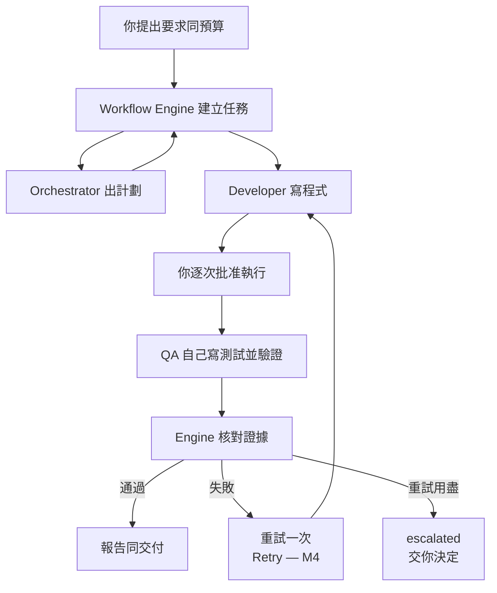

# AI Engineering Team

一個「個人 AI 工程團隊」嘅設計同實作起點。目標唔係做另一個 AI 編程助手，而係一個接到目標之後，識計劃、分工、執行、獨立驗證同匯報嘅小型系統。核心係一個自家寫嘅 Python 控制層，唔用 agent framework。

## 1. 呢個系統做咩

你講一個目標，例如「寫一個 Snake 遊戲」。系統會拆成任務，交俾 Developer 實作，再由獨立 QA 測試，最後由 Workflow Engine 決定收貨或者停手報告。AI 負責思考同動手，但流程、權限、預算同「收唔收貨」都由程式控制，最終決定權喺你手上。

QA 未通過時，系統會帶住 QA 失敗證據重試一次（`max_attempts = 2`，包含首次 attempt）；用盡仍然失敗就標 `escalated` 並停手交你決定。

架構採用 Hybrid：核心決策同流程自己寫，provider SDK 等 commodity 部分可以直接採用；Phase 1 唔使用 agent framework。

### 1.1 專案設定（Project Configuration）

呢個表係專案設定值；Protocol 只定義流程，唔會重複呢啲值。

| Field | Value |
|---|---|
| Project name | AI Engineering Team |
| Project root | `c:/AIProjects/AIEngineeringTeam` |
| Primary entry document | `AI_Engineering_Team.md` (project context; the AI operating entry point is `AGENTS.md`, see AGENTS §2) |
| Compact project state document | `PROJECT_STATE.md` |
| Working-rules entry point | `AGENTS.md` |
| Architecture / design documents | `plans/phase1-architecture-plan.md`, `plans/adr-001-hybrid-architecture.md` |
| Decision records | `plans/adr-001-hybrid-architecture.md` |
| Status / progress documents | `plans/phase1-architecture-plan.md` (the only formal record of milestones, acceptance and evidence); `PROJECT_STATE.md` (short progress snapshot); `AI_Engineering_Team.md` (project principles and governance); `README.md` (project overview and document entry point) |
| Technical specifications | `plans/phase1-architecture-plan.md`, `plans/snake-spec.md` |
| Tests / evidence / logs | `tests/`, `runs/`, `projects/` |
| Git repository | `https://github.com/yun07/AIEngineeringTeam` |
| Baseline branch | `main`; review branches are based on the latest `origin/main` |
| Current milestone / phase | Phase 1 in progress, not accepted; see [`PROJECT_STATE.md`](PROJECT_STATE.md) |
| Current task | No task authorised; current position is recorded in [`PROJECT_STATE.md`](PROJECT_STATE.md) |
| Configured language | Cantonese, Traditional Chinese |
| Documentation language policy | `README.md`: Traditional Chinese; `AGENTS.md` and `UNIVERSAL_SESSION_ALIGNMENT_PROTOCOL.md`: English |
| Environment | Conda `ai-team`, Python 3.12.16 |
| Preflight command | `python scripts/preflight.py` |
| Document authority order | `AI_Engineering_Team.md` > `plans/adr-001-hybrid-architecture.md` > `plans/phase1-architecture-plan.md` |
| Documentation index and reading order | [README.md](README.md) §7 — where each document type is described and when to read it; the mandatory bootstrap order is defined in AGENTS.md §2.1 |
| Project-specific restrictions | Read-only during alignment; Phase 1 forbids package installation; no agent framework; every generated-code execution needs its own approval; only the engine reads secrets; document changes use a review branch and need Human merge approval |
| Project limitations | Git hook and CI are not installed; preflight is manual; local `main` may be behind `origin/main` while the working tree is protected |

### 1.2 新 Session 入口

1. Human 提供 `AGENTS.md` link 作為入口。
2. Bootstrap 步驟、alignment 模式（Full / Continuation Alignment）同每個模式嘅最少讀取次序，只喺 [`AGENTS.md`](AGENTS.md) §2 同 §2.1 定義一次；本 README 唔重複。
3. 本專案嘅 Project Configuration 喺上面 §1.1；Continuation Alignment 會讀 §1.1 同 [`PROJECT_STATE.md`](PROJECT_STATE.md)，其餘協定段落同任務文件只讀與任務相關嘅部分。
4. 狀態快照只係快照，唔証明 code 或 test 可用；需要時仍要對實際 code、tests 或 run evidence 核實。
5. 如果欄位缺失，標 `NOT CONFIGURED`；不要猜測 paths 或 project facts。

## 2. 四個角色

| 角色 | 負責 | 唔會做 |
|---|---|---|
| **Orchestrator** | 理解你嘅要求，出計劃同任務 | 直接改檔案，或自己決定流程 |
| **Developer** | 喺專案資料夾寫程式，完成後交摘要 | 批核自己嘅工作，或改 QA 測試 |
| **QA** | 自己寫測試、親手執行、交出證據 | 單信 Developer 嘅報告 |
| **Workflow Engine** | 管狀態、流程、重試、權限、預算、證據核對 | 交俾 AI 代替自己做決定 |

三個 AI 角色係獨立 session：各有自己嘅指令、工具、上下文同紀錄，唔會共用同一段對話。角色係「身份」，模型只係背後嘅技術；同一個模型可以扮演幾個角色，但角色之間仍然分開。

## 3. 一個任務點行

重點：Developer 同 QA 唔會直接對話。Engine 只會交一份有範圍嘅交接資料俾下一個角色，唔會成段對話倒過去。

## 4. 安全同控制原則

- **逐次批准**：每次執行 AI 寫嘅程式，你都要答 `y` 或 `n`。空白等於 No，冇批次批准，非互動執行一律當拒絕。
- **單一權威**：Workflow Engine 係唯一有權改流程、批核、預算同驗證標準嘅組件。任何 AI 角色都唔可以放寬自己嘅限制。
- **Hybrid 原則**：核心決策、流程同收貨權由自家 Python Workflow Engine 持有；provider SDK 等 commodity 元件可以替換，但冇決策權。Phase 1 唔用 agent framework，將來任何 framework 或 execution runtime 都要另立 ADR 同有證據支持。
- **密鑰隔離**：只有 Engine 可以讀 API key；AI 角色、交接資料、紀錄同子程序都唔會見到。
- **唔自動安裝**：缺少套件會通知你手動處理，Phase 1 冇安裝路徑。
- **成本上限**：有 token 同美元上限，超支會停，唔會無止境重試。
- **工具範圍**：檔案同指令有路徑同權限限制。呢個係防錯護欄，唔係真正沙盒，所以先要逐次批准執行。

## 5. Phase 1 目標

用 Snake 遊戲做第一次完整端到端測試：計劃 → 開發 → 獨立 QA → 證據核對 → 報告。先用假模型 FakeProvider 離線跑通整個流程，再用細預算試真模型。

刻意唔做（engine／執行層）：Docker 隔離、generated work 嘅 Git worktree 隔離、SQLite、斷點續跑、並行任務、外部監控、自我改進、Consultant 角色、手機或語音批准。Review 用嘅獨立 worktree 屬工具操作，唔係 Phase 1 engine isolation。

## 6. 現況

Phase 1 進行中，**未 acceptance**。即時位置、下一步同未授權事項見 [`PROJECT_STATE.md`](PROJECT_STATE.md)；milestone 狀態、驗收條件同證據以 [`plans/phase1-architecture-plan.md`](plans/phase1-architecture-plan.md) 為準；工作流程、審批同 review 規則見 [`AGENTS.md`](AGENTS.md)。專案限制（hook／CI 未安裝、preflight 要人手跑）見 §1.1 `Project limitations`。

## 7. 文件索引（唯一 Document Index）

Layer 0–1 係起步必讀；Layer 2–4 按任務需要再讀。最低 bootstrap 閱讀次序由 [`AGENTS.md`](AGENTS.md) §2.1 定義，本表唔重複該次序。

| 文件 | Layer | 幾時睇 | 範圍 |
|---|---|---|---|
| [`AGENTS.md`](AGENTS.md) | 0 | 每個 session 開始 | 全部 |
| [`PROJECT_STATE.md`](PROJECT_STATE.md) | 1 | 開始工作前；狀態快照，非權威 | 全部 |
| [`README.md`](README.md) §1.1 | 1 | 起步必讀（Project Configuration）；之後需要設定值時再查 | 設定表 |
| [`UNIVERSAL_SESSION_ALIGNMENT_PROTOCOL.md`](UNIVERSAL_SESSION_ALIGNMENT_PROTOCOL.md) | 2 | 做 alignment／對齊測試，或需要授權邊界細節 | 相關章節 |
| [`AI_Engineering_Team.md`](AI_Engineering_Team.md) | 3 | 涉及原則、治理或安全邊界；最高權威 | 相關章節 |
| [`plans/phase1-architecture-plan.md`](plans/phase1-architecture-plan.md) | 3 | 涉及 milestone、範圍、驗收或實作 | 相關章節 |
| [`plans/snake-spec.md`](plans/snake-spec.md) | 3 | 涉及 Snake fixture 嘅要求、criterion ID、headless mode 或 QA test plan | 全部（短文） |
| [`plans/phase1-backlog.md`](plans/phase1-backlog.md) | 3 | 查 deferred items、open decisions 或 three-role 同 two-role 比較計劃時 | 全部（短文） |
| [`plans/adr-001-hybrid-architecture.md`](plans/adr-001-hybrid-architecture.md) | 3 | 架構問題 | 全部（短文） |
| [`records/m0-environment-report.md`](records/m0-environment-report.md) | 4 | 需要 M0 環境證據時 | 需要時 |

## 8. 三個常用詞

- **Agent**：一個有自己指令、工具同上下文嘅角色，唔係一個模型名稱。
- **Context**：該角色今次收到嘅資料，唔係整個專案嘅全部對話。
- **Handoff**：Engine 交俾下一個角色嘅有限資料包，包括要求、驗收條件同檔案清單。

呢份 README 只係入口，唔取代上面任何一份文件。
