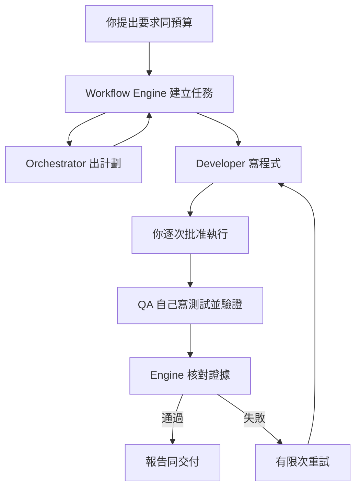

# AI Engineering Team

一個「個人 AI 工程團隊」嘅設計同實作起點。目標唔係做另一個 AI 編程助手，而係一個接到目標之後，識計劃、分工、執行、獨立驗證同匯報嘅小型系統。核心係一個自家寫嘅 Python 控制層，唔用 agent framework。

## 1. 呢個系統做咩

你講一個目標，例如「寫一個 Snake 遊戲」。系統會拆成任務，交俾 Developer 實作，再由獨立 QA 測試，最後由 Workflow Engine 決定收貨、重試或者停手問你。AI 負責思考同動手，但流程、權限、預算同「收唔收貨」都由程式控制，最終決定權喺你手上。

## 2. 四個角色

| 角色 | 負責 | 唔會做 |
|---|---|---|
| **Orchestrator** | 理解你嘅要求，出計劃同任務 | 直接改檔案，或自己決定流程 |
| **Developer** | 喺專案資料夾寫程式，完成後交摘要 | 批核自己嘅工作，或改 QA 測試 |
| **QA** | 自己寫測試、親手執行、交出證據 | 單信 Developer 嘅報告 |
| **Workflow Engine** | 管狀態、流程、重試、權限、預算、證據核對 | 交俾 AI 代替自己做決定 |

三個 AI 角色係獨立 session：各有自己嘅指令、工具、上下文同紀錄，唔會共用同一段對話。角色係「身份」，模型只係背後嘅技術；同一個模型可以扮演幾個角色，但角色之間仍然分開。

## 3. 一個任務點行

重點：Developer 同 QA 唔會直接對話。Engine 只會交一份有範圍嘅交接資料俾下一個角色，唔會成段對話倒過去。

## 4. 安全同控制原則

- **逐次批准**：每次執行 AI 寫嘅程式，你都要答 `y` 或 `n`。空白等於 No，冇批次批准，非互動執行一律當拒絕。
- **單一權威**：Workflow Engine 係唯一有權改流程、批核、預算同驗證標準嘅組件。任何 AI 角色都唔可以放寬自己嘅限制。
- **密鑰隔離**：只有 Engine 可以讀 API key；AI 角色、交接資料、紀錄同子程序都唔會見到。
- **唔自動安裝**：缺少套件會通知你手動處理，Phase 1 冇安裝路徑。
- **成本上限**：有 token 同美元上限，超支會停，唔會無止境重試。
- **工具範圍**：檔案同指令有路徑同權限限制。呢個係防錯護欄，唔係真正沙盒，所以先要逐次批准執行。

## 5. Phase 1 目標

用 Snake 遊戲做第一次完整端到端測試：計劃 → 開發 → 獨立 QA → 證據核對 → 報告。先用假模型 FakeProvider 離線跑通整個流程，再用細預算試真模型。

刻意唔做：Docker 隔離、Git worktree、SQLite、斷點續跑、並行任務、外部監控、自我改進、Consultant 角色、手機或語音批准。Console 同報告已經夠用。

## 6. 現況同下一步

**現況**：架構同 Phase 1 藍圖已完成，未開始寫程式。

**下一步**：M0 檢查 `ai-team` 環境（Python、pip、openai、pytest、tkinter）同 Git 狀態，整理 `.gitignore` 同 `.env.example`。跟住 M1 用 FakeProvider 做第一條「行得通嘅最小版本」：出計劃、寫檔案、執行上限、出報告。

## 7. 文件邊份最權威

| 文件 | 幾時睇 |
|---|---|
| [`AI_Engineering_Team.md`](AI_Engineering_Team.md) | 最高權威，講願景同原則。任何衝突以佢為準。 |
| [`plans/phase1-architecture-plan.md`](plans/phase1-architecture-plan.md) | 落手做 Phase 1 時睇嘅實作藍圖。 |
| [`plans/oss-architecture-research.md`](plans/oss-architecture-research.md) | 想知點解唔用現成框架時睇。 |
| [`plans/architecture-decision-review.md`](plans/architecture-decision-review.md) | 想查 Build、Adopt、Hybrid 嘅決策理由時睇。 |

## 8. 三個常用詞

- **Agent**：一個有自己指令、工具同上下文嘅角色，唔係一個模型名稱。
- **Context**：該角色今次收到嘅資料，唔係整個專案嘅全部對話。
- **Handoff**：Engine 交俾下一個角色嘅有限資料包，包括要求、驗收條件同檔案清單。

呢份 README 只係入口，唔取代上面任何一份文件。
