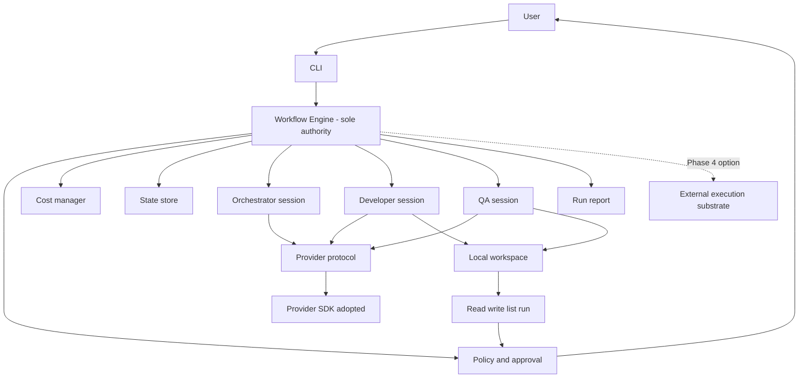
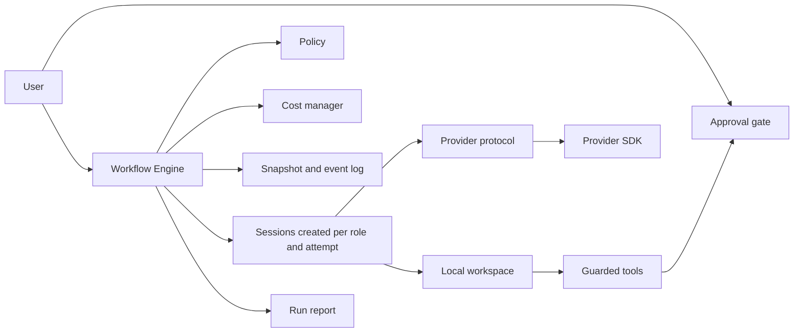

# Architecture Decision Review — Build, Adopt or Hybrid

**Purpose:** Second-round decision exercise for the Generic AI Engineering Team.
**Date:** 19 November 2026
**Status:** Decision document for human approval. No project documents or source code were modified.
**Inputs:** [`AI_Engineering_Team.md`](../AI_Engineering_Team.md), [`phase1-architecture-plan.md`](phase1-architecture-plan.md), [`oss-architecture-research.md`](oss-architecture-research.md)

---

## 0. Evidence Status

This review has the same access limitation as the first round, and it must be stated plainly.

- **Available and read:** the two project documents and the first research report in this workspace.
- **Not available:** the four framework repositories, their source trees, their test suites and their current online documentation. No network or browser tooling exists in this environment, and no clones are present.
- **Therefore:** statements about those frameworks are prior knowledge, inference or recommendation, tagged **[H]**, **[M]** or **[L]** as in the previous report. Nothing below claims that code was inspected or executed in this session.
- **What is verified here:** only that our own documents say what they say, and that the workspace contains no framework source.

The recommendations are designed so that this limitation does not decide the outcome. The decisive arguments rest on our own requirements and on the shape of the work, not on unverifiable framework details.

---

## 1. Decision Summary

**Recommended option: C, Hybrid — a thin custom core that adopts commodity components now and leaves defined seams for mature runtimes later.**

"Hybrid" here does not mean integrating a framework in Phase 1. It means:

- The Python application owns planning, workflow state, permissions, approval, budgets, retries and QA acceptance.
- Commodity work is adopted: the provider SDK, standard library persistence, standard logging, and later a workspace runtime.
- Agent frameworks are treated as replaceable execution substrates behind interfaces. None is adopted now, because none earns its weight for a three-role sequential pipeline.

This is the honest middle path. It is neither "build an agent framework" nor "never adopt anything".

The single most important sentence in this document:

> **The Python Workflow Engine is the sole authority over execution, permissions, state and cost. Every other component, including any future framework, is a subordinate mechanism with no decision rights.**

---

## 2. Challenging the First-Round Conclusions

The first report argued for BUILD in almost every row. That was directionally right but too absolute. Three corrections matter.

### 2.1 Correction: "BUILD" was applied to work that should be ADOPT

The first report put the provider adapter, logging and persistence under BUILD. That was imprecise.

- Provider access should be **ADOPT** at the SDK level inside our own protocol. Writing HTTP and retry logic ourselves is wasted effort.
- Persistence should be **ADOPT** of standard library facilities, not a custom storage engine.
- Logging should be **ADOPT** of the standard logging module, not a bespoke logger.

The right rule is: **BUILD the decisions, ADOPT the mechanics.**

### 2.2 Correction: the Workspace seam was premature

The first report recommended adding a `Workspace` protocol in Phase 1 so a container backend could arrive later. That contradicts the project's own anti-premature-abstraction principle.

A protocol with exactly one implementation is not a seam; it is ceremony. The correct Phase 1 choice is a single `LocalWorkspace` class with a narrow, deliberate surface. If a container backend is ever added, the protocol is extracted then, from two real implementations.

This is the only place where the existing plan would have become more complicated than necessary, and it is a recommendation to simplify, not to expand.

### 2.3 Correction: framework lock-in was argued too broadly

LangGraph has a stateless mode of use: run a graph without a checkpointer. That removes most persistence lock-in. But it also removes most of the reason to use LangGraph at all. A three-step pipeline in a stateless graph is a verbose `for` loop.

So the lock-in argument should be precise:

- **LangGraph used statelessly:** low lock-in, low benefit.
- **LangGraph used with checkpointers and interrupts:** real benefit for durable resume and human-in-the-loop, high lock-in through its state and checkpoint formats.
- **LangGraph never adopted:** the benefit is deferred, and the cost is building resume later if it is ever needed.

That is a genuine trade-off, not a refutation. Section 4 sets explicit triggers.

---

## 3. Requirements as Testable Constraints

The ten non-negotiables are treated as constraints that any option must satisfy. They are restated here as checks, because they decide the framework question more than any feature list does.

| # | Requirement | How it constrains the architecture |
|---|---|---|
| 1 | Independent sessions and responsibilities | A role record plus a fresh session per run, task, attempt and role |
| 2 | Independent Developer and QA contexts | No shared message list, no transcript passing, QA bundle built by the engine |
| 3 | Deterministic workflow control | Transitions computed by Python from state, never chosen by a model |
| 4 | QA evidence verified by code | Reported commands and exit codes cross-checked against the tool audit log |
| 5 | Human approval for risky operations | A blocking gate before execution, defaulting to no |
| 6 | Explicit execution limits and budgets | Pre-call token and USD checks with a hard stop |
| 7 | Replaceable model providers | A narrow protocol, no provider concepts in the engine |
| 8 | Controlled file and tool access | Per-role allowlists, path containment, scrubbed child environment |
| 9 | Bounded handoffs | Engine-generated bundles with size limits, never transcripts |
| 10 | One-person maintainability | One language, one process, few dependencies, inspectable state |

Requirements 3, 4, 5 and 6 are the ones frameworks handle worst, because each framework has its own opinion that differs from ours. This is the core of the decision.

---

## 4. Framework Re-Examination

### 4.1 LangGraph as a workflow mechanism

**The honest question:** can we use LangGraph as the outer execution mechanism without surrendering control?

**What LangGraph would own if adopted**

- Scheduling of nodes and edges, including superstep boundaries.
- Checkpoint storage and serialisation, if checkpointers are used.
- Interrupt and resume mechanics, if used for approvals.
- Event streaming vocabulary used for debugging.
- Retry scheduling, if node retry policies are used.

**What our application would keep**

- The task model, states and transition rules.
- Prompts, role definitions and tool permission sets.
- Tool execution, path checks, command allowlisting and environment scrubbing.
- Approval decisions, including the classifier and the yes-or-no gate.
- QA evidence validation and acceptance.
- Cost accounting, pricing and budget stops.
- Report generation.
- The provider client.

**Answers to the six questions**

| Question | Answer | Confidence |
|---|---|---|
| Retain our own state schema? | Yes, LangGraph accepts a custom object as graph state. But if checkpointing is used, that schema is serialised by LangGraph, so its format becomes a migration concern. | [M] |
| Keep our own permission and approval checks? | Yes for tool-level checks, which live inside our tool wrapper. But if graph interrupts are used for approvals, approval state moves into the graph state, creating a second authority. | [M] |
| Independently control execution, retries and budgets? | Budgets are controllable because every model call goes through our client. Retries are partially duplicated: LangGraph retry policy plus our attempt counter risks two retry layers. | [M] |
| Separate Developer and QA contexts? | Possible, but only with strict state partitioning or separate graph invocations per agent. Shared graph state makes leakage the default. | [H] |
| Avoid LangSmith and external telemetry? | Yes. LangSmith is opt-in and callback-based. LangGraph itself is not a telemetry client. | [M] |
| What if we replace it later? | Low cost if used statelessly, because the graph is thin. Moderate to high cost if checkpointing, thread identifiers or interrupt payloads are in use. | [M] |

**The decisive point**

The features that justify LangGraph are durable resume, human-in-the-loop interrupts, parallel fan-out and long-running threads. Phase 1 needs none of them:

- Runs are short and sequential.
- Approval is a synchronous console prompt.
- Failure recovery is "rerun the command".
- State is a single JSON snapshot.

Adopting LangGraph for a plan, a Developer step and a QA step would add a runtime, a state model and an event vocabulary to replace roughly one hundred lines of explicit routing. The cost is real; the benefit is deferred to features we do not yet need.

**Verdict: DEFER, with explicit triggers.** Adopt LangGraph only if at least one of these becomes true:

1. A run must survive process restart and resume mid-task.
2. Approvals must be answered hours later or remotely.
3. Tasks must fan out in parallel with deterministic joins.
4. Runs must coordinate across days.

If a trigger fires, the right integration is LangGraph as a subordinate executor: our engine keeps policy, cost, evidence and final verdict, and delegates only execution scheduling and checkpoints. That integration should be evaluated against building a small resume record, which is likely cheaper for a single-user system.

---

### 4.2 CrewAI

**What it is good at:** getting a role-based crew running quickly, with task output expectations, guardrails, memory and usage metrics.

**Why it does not fit**

- **Delegation is model-driven.** A hierarchical manager chooses coworkers. Requirement 3 requires Python to choose. Disabling the manager and using sequential mode removes most of the framework's value.
- **Prompt scaffolding is opinionated.** Role, goal and backstory inflate tokens, and persona text is not a permission model. Our roles are instructions plus tools.
- **Context accumulates by default.** Memory layers and task context encourage more information flow, which works against requirement 9.
- **Verification is guardrails, not evidence.** A guardrail validates output shape or quality; it cannot confirm that a command ran with the claimed exit code.
- **Budget enforcement is weak.** Usage metrics are reported, but hard USD stops are not a core guarantee. **[M]**
- **Telemetry defaults matter** for a private personal system and must be audited. **[M]**

**Components worth taking independently**

- The explicit role, task and expected-output schema.
- The guardrail idea as an optional deterministic output check.
- The event-driven Flow vocabulary as inspiration for a readable pipeline.

These are small design ideas, not dependencies. Adopting CrewAI to obtain them would import the rest.

**Verdict: reject as a dependency. ADAPT the task and guardrail vocabulary.**

---

### 4.3 OpenHands software-agent-sdk

**What it offers:** a ready-made agent loop plus a workspace abstraction with a Docker-backed runtime, tool execution inside that workspace, and a confirmation policy.

**The integration boundary that would work**

Our engine would keep planning, task states, retries, approval policy, cost policy, QA acceptance and reporting. OpenHands would run one Developer conversation inside one workspace and return a structured result:

```text
run_developer(bundle, allowed_tools, limits) -> {
  summary, files_changed, commands_executed, usage, exit_status
}
```

The engine would then run QA against the same workspace, or an equivalent one, and validate the evidence itself.

**Why it is not a Phase 1 choice**

- **Docker on Windows.** The runtime depends on Docker with WSL2 or a comparable backend. Availability on this machine is unconfirmed. **[M]**
- **Two approval systems.** OpenHands has its own confirmation policy. Ours must remain authoritative. Reconciling them is extra code, and the risk of an action slipping through the weaker gate is real.
- **QA symmetry.** Isolation is only meaningful if QA verifies inside the same kind of environment. Adopting OpenHands for the Developer alone would create asymmetric verification.
- **Runtime surface.** Server mode, event logs and session persistence add concepts and failure modes that a one-person project must operate.
- **Version churn.** It is a newer, fast-moving project. **[M]**

**What it would buy later**

Real isolation for executing AI-written code, which is our weakest point in Phase 1. That is a Phase 4 concern, and it is the strongest reason to keep a narrow workspace surface now so the swap is possible later.

**Verdict: DEFER, candidate for Phase 4 as an execution substrate behind our own interface. Not a Phase 1 dependency.**

---

### 4.4 Microsoft Agent Framework

**Potential advantages**

- Clean separation of agent and thread, which matches our identity and session model.
- Typed executor-and-edge workflows with checkpointing and request-response steps.
- Built-in OpenTelemetry, which fits requirement 10's observability later.

**Reasons it is not the right choice now**

- **Preview maturity.** Public-preview APIs can break. A personal system that must remain operable for years should not depend on a preview runtime. **[M]**
- **.NET-first.** The Python surface trails the .NET documentation and samples. Our project is Python on Windows. **[M]**
- **Ecosystem gravity.** Samples and tooling lean toward Azure and Microsoft hosting. Optional, but it shapes examples and support. **[M]**
- **No advantage over LangGraph for our specific gaps.** It does not provide evidence-validated QA, hard USD budgets or governance.

Microsoft Agent Framework is the most interesting of the four for typed workflows and human-in-the-loop, but it solves problems we have deliberately deferred, using a maturity level we should not adopt.

**Verdict: DEFER and re-evaluate at a stable release if durable workflows and OpenTelemetry become real needs.**

---

## 5. What We Actually Need to Build

The comparison above shows the frameworks cluster around capabilities we deferred. The table below decides each component against the requirements, not against feature envy.

| Component | Decision | Why | Revisit trigger |
|---|---|---|---|
| Orchestrator / Planner | **BUILD** | One model call returning a schema-validated plan, with Python enforcing task limits. This is a few dozen lines plus validation, and it must not own routing. | Plans need multi-step replanning mid-run |
| Agent session runtime | **BUILD** | A prompt, a message list, a tool loop, a turn cap and a transcript. Frameworks add concepts and dependency weight for roughly two hundred lines. | Need process isolation or heavy multimodal tooling |
| Role definitions | **BUILD** | Three prompt files plus a typed record: name, tools, model key, output schema. CrewAI's persona fields are not needed. | Roles grow beyond a dozen with shared capabilities |
| Context handoff | **BUILD** | The handoff must exclude transcripts, be size bounded and be generated by the engine. No framework can guarantee our exclusion rules. | Handoffs need retrieval over project knowledge |
| Workflow engine | **BUILD** | Deterministic transitions, attempt counting, budget stops and evidence acceptance. This is the project's core value and its governance. | Durable resume or parallel fan-out becomes required |
| State persistence | **BUILD** on standard library | A JSON snapshot plus one append-only event log is sufficient and inspectable. No database, no checkpoint format. | Concurrency, multi-run operation or large histories |
| Workspace and tool execution | **BUILD** now, **ADAPT** later | Local directory with path containment, per-role allowlists and a scrubbed child environment. Container runtime is a later backend, not a current abstraction. | Executing untrusted code routinely, or moving to Phase 4 |
| QA agent runtime | **BUILD** | Same session runtime with a different role, prompt, tool set and write scope. Reusing the runtime is the point; a separate framework would duplicate it. | Never, realistically |
| QA evidence validator | **BUILD** | The engine compares reported checks with the tool audit log. This is unique to us and central to trust. | Evidence grows beyond commands and files |
| Human approval | **BUILD** | Synchronous y or n, default no, non-interactive deny, recorded decision. No resume state needed. | Approvals must survive restarts or arrive remotely |
| Retry and escalation | **BUILD** | Attempts and costs counted by the engine, one retry path, escalation to the user. Framework retry policies would duplicate or hide this. | Retry needs backoff across process boundaries |
| Cost tracking and budgets | **BUILD** | Pricing from configuration, pre-call checks, per-agent attribution and a hard stop. No framework provides enforceable USD budgets in the way we need. | Many providers with complex price structures |
| Provider adapter | **ADOPT** SDK inside a **BUILD** protocol | Use the provider SDK for transport, retries and usage. Keep our own neutral message and tool types. Consider LiteLLM only if provider count grows. | Three or more providers, or non-token billing |
| Logging and observability | **ADOPT** standard logging, **DEFER** telemetry | Structured logs and JSONL events are enough. OpenTelemetry is a later addition and not a Phase 1 dependency. | Multi-service or hosted monitoring |
| Evaluation and self-improvement | **DEFER** | Not needed for the Snake test. The charter already defines the governed process; the evidence base is the run records. | Phase 5, after reliability is demonstrated |

### 5.1 What this means in plain terms

- The custom code is not a framework. It is a loop, a state machine, three prompts, a tool executor, a cost check and an evidence check.
- The only adopted runtime dependency for Phase 1 is the provider SDK, plus pytest for development.
- Every framework decision is deferred with a written trigger, so "not now" does not become "never considered".

---

## 6. Comparing the Real Costs

Relative assessment, not estimates. Assumptions: one developer, Python on Windows, sequential single-user runs, Snake written with the standard library, no multi-day runs in Phase 1.

| Criterion | A. Fully custom | B. Framework-based | C. Hybrid, custom core |
|---|---|---|---|
| Initial implementation | Medium. Most effort is tool safety, approval and evidence, which all options need. | Medium to high. Still builds approval, QA acceptance and budgets, plus framework learning and integration. | Medium. Slightly more discipline at component boundaries, no integration tax. |
| Ongoing maintenance | Low to medium. Own code, two dependencies. | Medium to high. Framework releases, adapter packages, checkpoint migrations. | Low to medium. Own core, few dependencies, optional backend swaps. |
| Complexity for one developer | Low. One process, one language, inspectable state. | High. Framework concepts, two state models, event streams, hidden retries. | Medium to low. Core is small; optional pieces are isolated. |
| API cost implications | Lowest. Hand-written prompts, tight context, explicit caps. | Similar for custom prompts, higher if prebuilt agents, memory or persona scaffolding are used. | Lowest. Same prompt control, explicit caps. |
| Framework lock-in | None. | High through runtime, checkpoints and model interface. | Low. Interfaces are ours; adopted pieces are replaceable. |
| Security and isolation | Weakest initially, because tools run in-process. | Same default weakness; sandboxing is not automatic. | Can improve later by swapping the workspace backend without touching the engine. |
| Debugging failures | Easiest. JSON state, JSONL events, plain Python stack traces. | Harder. Failures may sit inside graph scheduling, checkpoint serialisation or framework callbacks. | Easy to medium. Our layer is transparent; optional backend is isolated. |
| Adding future capabilities | Each capability is bespoke. | Cheapest for durable resume, parallel fan-out and human-in-the-loop. | Cheapest overall if triggers are honoured: adopt a runtime only for the capability that needs it. |

**Interpretation.** Option B only wins if we expect, soon, the exact features we deferred: durable resume, parallel fan-out and long-lived approvals. Nothing in the Phase 1 scope or the charter suggests that. Option A understates the value of adopting provider and workspace runtimes later. Option C matches the evidence.

---

## 7. Recommended Architecture

### 7.1 The authority question

**The Python Workflow Engine is the ultimate authority over execution, permissions, state and cost.**

- Agents propose plans, edits, reports and verdicts. They never transition tasks, approve actions, change budgets or accept their own work.
- The engine decides the next action from state, enforces limits, asks the human, validates evidence and writes the final result.
- The policy module enforces tool rules; the cost manager enforces spend; both are called by the engine and cannot be bypassed by an agent.
- Provider adapters and workspaces are mechanisms. They may fail, but they cannot decide.

If a framework is ever added, it sits below this line as an execution substrate. It must not hold approval state, budget authority or the accepted verdict.

### 7.2 Diagram



### 7.3 How each behaviour works

**Independent sessions.** The engine creates a new session object per run, task, attempt and role. A session receives a prompt file, a tool allowlist, a model key and one handoff bundle. It has its own message list and transcript path. No session object is shared between agents.

**Developer and QA exchange.** They never talk. The engine builds the QA bundle from state: request, acceptance criteria, file manifest with hashes and the previous verdict when retrying. Developer transcripts, reasoning and claims are excluded. QA returns a verdict with checks; the engine validates it against the audit log and writes the report.

**QA evidence verification.** The engine requires at least one executed command, requires every reported check to match a command and exit code in the audit log, and downgrades any mismatch to a failure. This is deterministic code. The model's verdict is an input, not the decision.

**Approval interrupts execution.** Before any CONFIRM-class action, the tool layer calls the approval gate and blocks. The prompt shows argv, working directory and target files. Only y or n is accepted, empty means no, and non-interactive input means denial. A denial moves the task to blocked and the run ends with a report.

**Retries and budgets.** The engine counts attempts and LLM calls, checks the remaining budget before each call, and stops on exhaustion. Retry creates a new Developer session with the failed QA checks in its bundle. No framework retry layer exists to double-count.

**Workspaces and tools.** Each role has a path scope. The Developer may write inside the project but not in `qa_tests`. QA may write only in `qa_tests`. Commands run with a scrubbed environment, pinned working directory, timeouts and output caps. Installation is denied.

**Provider replacement.** The engine speaks a neutral message and tool format. A provider module maps that to the SDK, returns neutral content, tool calls and usage. Pricing lives in configuration. Swapping providers changes one module and a pricing entry.

---

## 8. Phase 1: Minimum Practical Scope

The existing plan is already close to minimal, but it can be trimmed. The test is simple: does the Snake run need it to prove the workflow?

### 8.1 Essential for Phase 1

1. Configuration with one provider key, one model per role and a pricing entry.
2. Fake provider first, so the whole loop runs offline.
3. Session runtime: prompt, message list, tool loop, turn cap, transcript, JSON output with one repair retry.
4. Three prompts: Orchestrator plan, Developer build, QA verify.
5. Tools: read, write, list and run, with path containment, per-role scopes, environment scrubbing, timeout and output cap.
6. Approval gate: y or n per execution, default no, non-interactive deny, decisions logged.
7. Engine: plan, Developer, QA, one retry, escalation, blocked states, final report.
8. State: JSON snapshot plus one append-only event log.
9. QA evidence validation against the audit log.
10. Cost: token counting, configured pricing, pre-call budget check and hard stop.
11. Snake fixture specification and a stdlib implementation target.

### 8.2 Useful but can wait

- `--plan-only` review mode.
- Per-role model overrides beyond one model.
- Cost breakdown by phase in the console, beyond the report.
- Session transcript rotation.
- Config validation beyond a single load-time check.
- Multiple tasks per plan. The Snake run needs one to two.
- Separate Workspace protocol. One local class is enough.
- Six scenario test modules. One parametrised module with six cases gives the same coverage with less ceremony.

### 8.3 Future, Phase 4 or later

- Container or remote workspace backend, possibly OpenHands.
- Git worktree isolation and automated branch handling.
- Durable resume and checkpointing, by building a small resume record or adopting LangGraph for that narrow job.
- Parallel task execution with deterministic joins.
- SQLite state and query tooling.
- OpenTelemetry and external monitoring.
- Evaluation harness and controlled self-improvement.
- Independent Consultant role and review reports.
- Remote or mobile approval.

### 8.4 Explicit non-goals for Phase 1

- No agent framework dependency.
- No plugin system.
- No event replay or time travel.
- No resumable approvals.
- No multi-user or hosted service.
- No model fine-tuning or prompt optimisation loop.

---

## 9. Where the Current Plan Is More Complex Than Necessary

The core is appropriately small. These items are over-specified for a one-person project and should be simplified before implementation, not expanded.

1. **Three JSONL logs.** Usage and approval records can be event types in one `events.jsonl`. One append-only file, one write path, no cross-file consistency question. Cost and approval views are filters.
2. **A separate handoff module.** The bundle builder is tens of lines and tightly coupled to state. It can live in the workflow module until it grows.
3. **A Workspace protocol.** One implementation does not justify a protocol. Use a single class with a narrow API and extract the interface when a second backend exists.
4. **Double configuration validation.** Loading plus a second pre-call check is redundant for a single-user tool. Validate once at load, and let the budget check naturally read pricing.
5. **Six scenario files.** One parametrised test module with six scenarios keeps the same coverage and reduces fixture duplication.
6. **Provider switch duplication.** `--fake` and a provider name in configuration are two ways to say the same thing. Keep one.
7. **Milestone ceremony.** Eight milestones for this scope is defensible for tracking, but the first five are one continuous build. Do not let milestone boundaries create documentation work that produces no code.

These are simplifications, not redesigns. The requirements, authority model and safety rules are unchanged.

---

## 10. Evidence, Confidence and Unresolved Questions

### 10.1 What is verified in this session

- The workspace contains the two project documents and the first research report. It contains no framework source, and no test or build was run.
- The project documents consistently require the engine to own state, approvals, budgets and QA acceptance.

### 10.2 What is inference or recommendation

- All statements about LangGraph, CrewAI, OpenHands and Microsoft Agent Framework behaviour, licence and maturity.
- The relative cost ratings in section 6.
- The expectation that a thin engine stays in the low thousands of lines.

### 10.3 Most important unresolved technical questions

1. **Does LangGraph import cleanly and behave on Python 3.12 Windows without optional telemetry or network calls?** Needs a real install and an offline test. **[M]**
2. **How portable is a LangGraph checkpoint store if we ever migrate away?** Needs schema inspection and a migration experiment. **[M]**
3. **What exactly does the OpenHands SDK expose versus the OpenHands server?** Confirmation policy, budget caps and workspace lifecycle may live in different layers. **[M]**
4. **Can OpenHands run QA in the same workspace with evidence our engine can validate?** Needs an integration spike if Phase 4 chooses it. **[L]**
5. **Is Microsoft Agent Framework's Python workflow API at parity with .NET, and what is its breaking-change policy in preview?** **[L]**
6. **Does CrewAI enforce any hard budget stop, and what telemetry is enabled by default?** **[M]**
7. **Is evidence validation sufficient to catch weak QA tests?** No. It prevents fabrication, not poor coverage. Human spot checks, or later mutation testing, are needed.
8. **Does an in-process approval prompt block cleanly on Windows when stdin is redirected?** Needs a small test in M2. **[H]**

---

## 11. Final Decision

### 11.1 Recommended option

**C — Hybrid.** A small custom core that owns orchestration, workflow state, sessions, QA acceptance, approval and cost, with provider access adopted from an SDK and mature execution substrates deferred behind narrow interfaces. No agent framework in Phase 1.

### 11.2 Component decisions

| Component | Decision | One-line reason |
|---|---|---|
| Orchestrator / Planner | **BUILD** | One schema-validated model call; routing stays in Python |
| Agent session runtime | **BUILD** | Prompt, tools, loop, turn cap and transcript are small and specific |
| Role definitions | **BUILD** | Three prompt files plus a typed record |
| Context handoff | **BUILD** | Transcript exclusion and size limits are our guarantee |
| Workflow engine | **BUILD** | Deterministic authority over state, retries and evidence |
| State persistence | **BUILD** on standard library | JSON snapshot plus one event log is sufficient and inspectable |
| Workspace and tool execution | **BUILD** now, **ADAPT** OpenHands later | Local guardrails now; real isolation is a Phase 4 problem |
| QA agent runtime | **BUILD** | Same runtime, different role, prompt and write scope |
| QA evidence validator | **BUILD** | No framework checks evidence against an execution log |
| Human approval | **BUILD** | Synchronous y or n, default no, recorded decision |
| Retry and escalation | **BUILD** | One attempt counter and one escalation path |
| Cost tracking and budgets | **BUILD** | Hard USD stops and per-agent attribution are central |
| Provider adapter | **ADOPT** SDK inside a **BUILD** protocol | Use the SDK for transport and retries; keep neutral types |
| Logging and observability | **ADOPT** standard logging, **DEFER** telemetry | Structured logs and JSONL suffice for one user |
| Evaluation and self-improvement | **DEFER** | Not needed for the Snake test; governed process is charter work |

### 11.3 Proposed architecture diagram



### 11.4 Phase 1 minimum scope

Build the eleven essentials in section 8.1, run the FakeProvider pipeline, then one small live run, then the Snake end-to-end success case. Everything else in section 8.2 is optional, and section 8.3 is out of scope.

### 11.5 Main trade-offs and risks

- **Isolation is logical, not physical.** Approval of every execution is the control, not path checks. Risk accepted for Phase 1.
- **The engine is custom code.** It is small, but it is ours to maintain. Mitigation: keep it plainly structured, with state and events inspectable.
- **QA can still be shallow.** Evidence validation stops fabrication, not weak tests. Mitigation: human spot checks and explicit acceptance criteria.
- **Deferred frameworks may become harder to adopt later.** Mitigation: narrow workspace surface, neutral provider protocol and a documented trigger list.
- **Prompt fatigue can weaken approval.** Mitigation: show the command and targets, keep the default as no, and never add batch approval.

### 11.6 Decisions that require human approval

1. Approve Option C: custom core, no agent framework in Phase 1.
2. Approve the simplifications in section 9 before they are reflected in the plan: one event log, no Workspace protocol, consolidated scenario tests, single provider switch.
3. Confirm the first live provider, model per role and run budget.
4. Decide whether OpenHands is the intended Phase 4 isolation candidate, which implies accepting Docker or WSL2 on this machine.
5. Approve the LangGraph triggers in section 4.1, so adopting it later requires evidence rather than preference.
6. Approve keeping evaluation, self-improvement and the Independent Consultant out of Phase 1.
