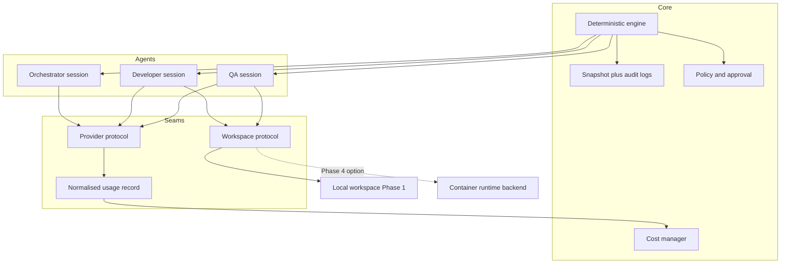

# Open-Source Architecture Research

**Purpose:** Inform the Phase 1 architecture of the Generic AI Engineering Team without adopting a framework.
**Status:** Desk review. Not verified against live repositories in this session.
**Date:** 19 November 2026
**Related documents:** [`AI_Engineering_Team.md`](../AI_Engineering_Team.md), [`phase1-architecture-plan.md`](phase1-architecture-plan.md)

---

## Verification Statement

The workspace contains no clone of any of these repositories, and this environment has no network or browser tooling. Nothing was fetched, built or executed for this report.

Every substantive claim therefore comes from prior knowledge of the public documentation, source layout and examples, and is tagged:

| Tag | Meaning |
|---|---|
| **[H]** | High confidence. Stable, widely documented behaviour that has not changed materially. |
| **[M]** | Medium confidence. Documented behaviour that may have shifted in recent releases. |
| **[L]** | Low confidence. Newer or fast-moving area. Verify before relying on it. |

Section 8 lists the exact files and questions to check before adopting anything. No claim here should be treated as a substitute for reading the current source.

---

## 1. Executive Summary

1. **Do not adopt any of the four frameworks for Phase 1.** Each owns the execution loop, state model or deployment surface that our design deliberately keeps in a small Python engine. The dependency and lock-in costs outweigh the saved code.
2. Three projects contain designs directly worth copying:
   - **LangGraph** for durable checkpoints, explicit interrupt points, node retry policy and fan-out.
   - **OpenHands software-agent-sdk** for separating the agent loop from a workspace runtime, Docker-backed isolation, confirmation policy and per-task limits.
   - **Microsoft Agent Framework** for typed threads, executor-and-edge workflows, request-based human input and built-in OpenTelemetry.
3. **CrewAI** contributes lighter ideas: an explicit role and task specification, task guardrails, usage metrics and event-driven Flows.
4. None of the four provides what our project most needs: a deterministic engine that owns task state, an independent verifier with evidence cross-checked against an audit log, hard USD budget stops and governance over the team's own rules. Those remain **BUILD**.
5. The existing Phase 1 plan needs no architectural change. Two low-cost seams are worth designing in from the start so later adoption is possible without a rewrite: a `Workspace` abstraction and a normalised usage record.

---

## 2. Repositories at a Glance

| Repository | Stack and licence | Primary abstraction | Workflow model | Persistence | Real isolation |
|---|---|---|---|---|---|
| [langchain-ai/langgraph](https://github.com/langchain-ai/langgraph) | Python and JS, MIT | `StateGraph` over typed state, compiled into a Pregel-style runtime | Nodes, edges, conditional routing, supersteps | Checkpointers: memory, SQLite, Postgres | No |
| [crewAIInc/crewAI](https://github.com/crewAIInc/crewAI) | Python, MIT | `Agent`, `Task`, `Crew`, plus `Flow` | Sequential or manager-led crew; event-driven Flows | Flow state persistence, memory stores | No |
| [OpenHands/software-agent-sdk](https://github.com/OpenHands/software-agent-sdk) | Python, MIT | `Conversation`, `Agent`, `Workspace`, `EventLog` | Agent loop inside a workspace runtime | Conversation events, remote agent server | Yes, Docker workspace |
| [microsoft/agent-framework](https://github.com/microsoft/agent-framework) | Python and .NET, MIT | `ChatAgent`, `AgentThread`, `WorkflowBuilder` | Executors and edges, with checkpointing and request-response steps | Thread state, workflow checkpoints | No, relies on external tools |

Maturity note: LangGraph and CrewAI are widely used with large public codebases. The OpenHands SDK is newer and extracted from the OpenHands application. The Microsoft Agent Framework is a public preview. **[M]**

---

## 3. Area-by-Area Analysis

### 3.1 Orchestrator and task delegation

**LangGraph [H].** Delegation is expressed directly in the graph. A supervisor node inspects state and returns the next node or a `Command` that routes to another subgraph. Separate supervisor and swarm packages exist, but the core mechanism is conditional edges plus shared state. Delegation logic is ordinary Python, so it can be deterministic.

**CrewAI [H].** A `Crew` runs tasks sequentially, or in hierarchical mode where a manager agent, driven by `manager_llm` or `manager_agent`, decides which coworker receives the next task. Agents may delegate to coworkers when `allow_delegation` is enabled. The delegation decision is model-driven, not code-driven.

**OpenHands SDK [M].** The SDK is agent-centric rather than team-centric. A `Conversation` runs one agent against one workspace. Multi-agent coordination is left to the caller, typically the OpenHands server or an application layer.

**Microsoft Agent Framework [M].** `WorkflowBuilder` composes executors with edges, including fan-out, fan-in, switch-case groups and request-response executors. Multi-agent orchestration patterns such as sequential, concurrent, handoff and Magentic are documented samples built on the same workflow primitives.

**Worth adopting.** LangGraph's rule that routing is code and state is data. Microsoft's executor-and-edge naming, which keeps agents and control flow separate.

**Trade-offs.** CrewAI's hierarchical manager is attractive in demos but makes the control plane non-deterministic and hard to bound by budget. LangGraph's graph is deterministic only if the developer resists placing routing decisions inside model output.

**Fit.** Our engine already performs this role with a pure `next_action` function. Keep it. Learn from the graph metaphor, but do not hand control to a framework.

---

### 3.2 Independent agent identities and sessions

**LangGraph [H].** An agent is a node or subgraph plus a prompt. There is no first-class persistent agent identity. Identity is implied by graph structure and by the thread identifier used for checkpointing. Two agents can share a state channel, which is convenient but blurs context boundaries.

**CrewAI [H].** Identity is explicit and opinionated: `role`, `goal`, `backstory`, `tools`, `llm`, plus memory configuration. Each task is assigned to an agent. This is the closest of the four to a persistent agent record, though it is prompt scaffolding rather than a permissioned identity.

**OpenHands SDK [M].** An `Agent` object pairs an LLM with a tool set and an agent context; a `Conversation` gives it a session. The same agent definition can be reused across conversations. Identity and session are separated more cleanly than in the other three.

**Microsoft Agent Framework [M].** `ChatAgent` is the identity; `AgentThread` is the session. A thread carries conversation state and can be persisted or resumed. This is the cleanest documented identity-versus-thread separation.

**Worth adopting.** The explicit split between an agent definition and a session instance, which our plan already calls agent identity versus agent session. Microsoft's thread object and OpenHands' conversation object are good models for that seam.

**Trade-offs.** CrewAI's mandatory backstory and goal text inflates prompts and encourages persona drift. LangGraph's shared state makes it easy to accidentally leak one agent's reasoning into another's context.

**Fit.** BUILD, as planned. Add nothing beyond the role record and the fresh session.

---

### 3.3 Context isolation and handoff

**LangGraph [M].** Context isolation is optional. State keys are shared across the graph unless a subgraph declares its own schema. Checkpointing stores full state, so an operator can inspect everything, but agents receive whatever the node passes into the prompt. There is no built-in redaction or minimum-context handoff.

**CrewAI [H].** Tasks can declare `context`, which passes prior task outputs into a task. Memory layers add short-term, long-term, entity and contextual memory. This is convenient, but the default direction is accumulation: more context flows forward unless the developer prunes it.

**OpenHands SDK [M].** A conversation has an event log, and the agent receives a condensed view of that log plus workspace state. Cross-conversation transfer is the caller's responsibility. This naturally limits handoff to explicit inputs.

**Microsoft Agent Framework [M].** Threads hold messages; context providers can inject additional context such as memory or retrieval. Handoff samples pass the conversation or a summary to the next agent. Thread isolation is per agent unless explicitly shared.

**Worth adopting.** The principle that a handoff is a deliberate, bounded artefact, not a transcript. OpenHands' event-log-plus-condensed-view is a useful mental model for our transcript-and-bundle split.

**Trade-offs.** LangGraph and CrewAI both make context sharing the path of least resistance. Any framework with a shared state channel needs discipline to keep QA independent.

**Fit.** BUILD the serialized handoff bundle exactly as planned. This is a differentiator, not a gap.

---

### 3.4 Deterministic workflow control

**LangGraph [H].** Execution is a Pregel-style loop of supersteps over a compiled graph. Edges and conditional edges decide routing. The engine, not the model, advances the loop. `Command` allows a node to update state and choose the next node. Parallel branches and `Send` fan-out are supported.

**CrewAI [M].** Sequential crews are deterministic in order. Hierarchical crews are not, because the manager decides. Flows add a deterministic, event-driven layer with start, listen and router decorators, and can invoke crews as steps. Flows are the more relevant half for us.

**OpenHands SDK [M].** The agent loop is deterministic in mechanics: receive, call model, execute tools, repeat until done or a limit is hit. Task-level routing between agents is not part of the SDK.

**Microsoft Agent Framework [M].** A workflow is a graph of executors and edges with typed messages. Routing can be conditional, and the runtime advances the graph. Checkpointing and request-response steps are first-class.

**Worth adopting.** LangGraph's separation of routing from model output, and its event vocabulary of node start, node end, state update and interrupt. Microsoft's typed edges.

**Trade-offs.** Adopting either means their runtime owns the loop, their event model becomes our debugging surface, and their release cadence becomes our upgrade risk.

**Fit.** BUILD the pure state machine. Copy the vocabulary, not the runtime.

---

### 3.5 State management and persistence

**LangGraph [H].** Checkpointers save state per thread and per superstep, enabling resume, time travel and human-in-the-loop. Backends include in-memory, SQLite and Postgres. State schemas use typed dictionaries with reducers that merge updates. This is the strongest persistence design of the four.

**CrewAI [M].** Crew memory is stored in local storage, commonly SQLite for long-term memory. Flows support persisted state through a decorator, backed by SQLite, which supports resuming a flow. There is no general per-step checkpoint of an agent run.

**OpenHands SDK [M].** Conversation state and an append-only event log are the core records. The agent server persists conversations so clients can reconnect and resume. Event sourcing is central.

**Microsoft Agent Framework [M].** Threads hold message history and can be serialised. Workflow checkpoint storage captures executor state at supersteps, with in-memory and file-based implementations in packages and samples. **[L]**

**Worth adopting.** LangGraph's distinction between authoritative state and an event history, and its insistence that resume is a first-class operation. Our plan already has a snapshot plus an audit log and deliberately defers replay.

**Trade-offs.** Checkpointing every superstep adds storage and schema churn. Event sourcing adds reconstruction complexity. For a single-user, sequential Phase 1, both are premature.

**Fit.** BUILD the JSON snapshot and logs now. Revisit SQLite when concurrency or recovery demands it; revisit checkpoint-style resume only when approvals or long runs require it.

---

### 3.6 Tool execution and workspace management

**LangGraph [H].** Tools are functions bound through the LangChain tool interface and executed by a `ToolNode` in the same process. There is no workspace abstraction and no sandbox. Isolation is whatever the developer supplies.

**CrewAI [H].** Tools implement a `BaseTool` contract, with compatibility for LangChain tools and MCP. Execution is in-process. Some tools wrap external services. There is no workspace model.

**OpenHands SDK [M].** This is the differentiator. Tools such as bash and a file editor operate against a `Workspace`, which can be local or a Docker-backed runtime. The agent loop and the execution environment are separable, and a remote workspace is supported through the agent server. This is real isolation, not path checking.

**Microsoft Agent Framework [M].** Tools are typed functions or hosted tools, executed by the runtime. Workspace and sandboxing are not provided; isolation depends on the hosting environment.

**Worth adopting.** The `Workspace` seam and the rule that tool execution targets an environment rather than the orchestrator's process. OpenHands' confirmation policy per tool is also relevant to section 3.8.

**Trade-offs.** Docker adds startup cost, image management and a new failure mode. A remote server adds deployment complexity. For Phase 1 on Windows with a stdlib-only fixture, it is disproportionate.

**Fit.** ADAPT the seam now, BUILD the local workspace, and evaluate the OpenHands runtime as a Phase 4 isolation backend behind the same interface.

---

### 3.7 QA and independent verification

**LangGraph [M].** No verifier. Patterns exist where a reviewer node inspects another node's output, but nothing prevents both nodes from sharing context, and no evidence is checked against an execution log.

**CrewAI [H].** Task guardrails validate output, either with a function or an LLM, and a hierarchical manager reviews work. These improve output shape but are not independent verification of executed behaviour. Training and testing helpers exist for crews, but they are development utilities.

**OpenHands SDK [L].** The agent can run tests in its workspace, and the conversation records results. There is no separate verifier role and no evidence cross-check.

**Microsoft Agent Framework [L].** Evaluation integrations exist, mainly around datasets and evaluators in the Microsoft ecosystem. No structural separation between producer and verifier.

**Worth adopting.** CrewAI's guardrail concept as an optional extra check, provided it is deterministic where possible. Nothing else.

**Trade-offs.** Model-based review is still a model judging a model, and shared context makes it weaker than it appears. A deterministic check that the reported commands and exit codes exist in the audit log is stronger.

**Fit.** BUILD. This is the clearest case where none of the four fits, and our plan already leads.

---

### 3.8 Human approval and permissions

**LangGraph [H].** `interrupt` pauses a run at a defined point, persists state through the checkpointer, and resumes with `Command`. This supports approve, edit and reject flows. Permissions are not modelled; the developer decides where to interrupt.

**CrewAI [M].** `human_input` on a task triggers a prompt after the task output, mainly for review. There is no general risk classification or policy layer.

**OpenHands SDK [M].** Confirmation policy exists for tool calls, with security analysis that can flag risky actions, including model-assisted risk assessment. The OpenHands application exposes confirmation modes and risk levels.

**Microsoft Agent Framework [M].** Request-response executors allow a workflow to request information, including approval, and resume with the response. Approval is a workflow primitive rather than a permission system.

**Worth adopting.** The notion of a well-defined pause point with an explicit resume payload, and OpenHands' per-tool confirmation policy. Our synchronous y-or-n gate is a simpler version of the same idea.

**Trade-offs.** Model-assisted risk analysis can produce false negatives and is itself attackable. Persisted interrupts add state and recovery complexity, which our Phase 1 explicitly avoids.

**Fit.** ADAPT the pause-point concept, BUILD the deterministic classifier and synchronous gate, and keep per-execution approval. Revisit durable interrupts only for resumable or remote approvals.

---

### 3.9 Retry, failure handling and recovery

**LangGraph [H].** Per-node retry policies with exponential backoff, error handling edges, and durable resume from checkpoints. Failure is a routing concern, not a conversation.

**CrewAI [M].** Task retries exist in configuration, and hierarchical managers may reassign. Retry accounting is less explicit, and cost can grow quietly.

**OpenHands SDK [M].** Loop limits such as maximum iterations and error handling around tool calls. Recovery across process restarts is handled by conversation persistence and the server.

**Microsoft Agent Framework [M].** Checkpointed workflows can resume after failure. Retry is generally left to executors or hosting infrastructure.

**Worth adopting.** LangGraph's rule that retries are counted by the engine and scoped to a node, plus OpenHands' explicit iteration caps.

**Trade-offs.** Framework retries can mask systematic failure and inflate cost. Recovery features assume the framework's state format.

**Fit.** BUILD deterministic attempt counters and escalation, as planned. Cap retries by count and cost, not by elapsed time alone.

---

### 3.10 Token usage, cost management and observability

**LangGraph [M].** Usage metadata is available from provider responses. Observability is primarily LangSmith, a commercial service, plus callbacks and streaming events. There is no built-in budget enforcement.

**CrewAI [M].** Per-agent and per-crew usage metrics are exposed, and pricing is computed through its model integration layer. No hard budget stop is documented in the core. Telemetry is on by default with an opt-out.

**OpenHands SDK [M].** The LLM layer reports token usage and cost through its provider abstraction. The OpenHands application exposes per-task budget and iteration limits. This is the closest to enforcement among the four.

**Microsoft Agent Framework [M].** Responses carry usage details, and OpenTelemetry integration is documented. Cost policy is left to the application.

**Worth adopting.** A normalised usage record and OpenTelemetry-compatible spans. OpenHands' per-task cap as a design reference.

**Trade-offs.** Metrics without enforcement are reporting, not control. Commercial observability backends create lock-in. Default telemetry must be scrutinised for a private personal system.

**Fit.** BUILD the Cost Manager. It is small and central to our safety story.

---

### 3.11 Evaluation and controlled self-improvement

**LangGraph [M].** Evaluation is provided through LangSmith datasets and evaluators rather than in the library. There is no self-improvement loop and no rollback model.

**CrewAI [M].** Crew training and testing helpers can iterate on task behaviour. They are narrow development utilities, not a governed improvement process with evaluation and rollback.

**OpenHands SDK [L].** Evaluation is external. The event log makes offline analysis possible, which is useful raw material.

**Microsoft Agent Framework [L].** Evaluation hooks exist through Microsoft evaluation tooling. No self-improvement governance.

**Worth adopting.** The general shape of an experiment record: input, configuration, outcome, score. Our event log already provides the raw evidence.

**Trade-offs.** Any system that tunes its own prompts without a held-out comparison and a rollback path will drift. None of the four provides governance.

**Fit.** BUILD later. The charter already defines the controlled process; the engine's records are the evidence base. Keep this out of Phase 1.

---

### 3.12 Model-provider independence

**LangGraph [H].** Provider access goes through `langchain-core` chat model abstractions. Broad coverage, but adopting LangGraph effectively adopts the LangChain model interface and its release cadence.

**CrewAI [H].** Uses LiteLLM for provider access, which gives wide coverage through a single dependency and configuration surface.

**OpenHands SDK [M].** Uses a LiteLLM-based LLM abstraction with provider configuration by name, including custom base URLs.

**Microsoft Agent Framework [M].** Chat clients per provider package, including OpenAI, Azure OpenAI and others, with a shared message and tool abstraction.

**Worth adopting.** LiteLLM as an optional adapter behind our own narrow interface is a pragmatic way to gain providers without writing each client. Microsoft's chat-client-per-provider pattern is also sound.

**Trade-offs.** LiteLLM adds a large dependency and a second configuration language. LangChain's abstraction is the most invasive. A thin adapter over an OpenAI-compatible API covers many providers with almost no code.

**Fit.** BUILD the narrow provider protocol, as planned. Consider LiteLLM later only if the provider count grows beyond what a thin adapter handles.

---

## 4. Comparison Matrix

Legend: **Y** implemented, **P** partial or pattern only, **N** not provided. Confidence tags in brackets.

| Area | LangGraph | CrewAI | OpenHands SDK | Microsoft AF |
|---|---|---|---|---|
| Orchestrator and delegation | Y, graph routing and supervisor patterns [H] | Y, sequential or model-driven manager [H] | N, conversation-scoped [M] | Y, workflow plus multi-agent patterns [M] |
| Agent identity and sessions | P, node plus thread, no identity record [H] | Y, role and goal record, task assignment [H] | Y, agent definition plus conversation [M] | Y, agent plus thread [M] |
| Context isolation and handoff | P, shared state unless subgraph schemas used [M] | P, task context and accumulating memory [H] | P, per-conversation event log [M] | P, per-thread messages plus context providers [M] |
| Deterministic workflow control | Y, Pregel supersteps [H] | P, sequential crews; Flows are deterministic [M] | N, single agent loop [M] | Y, executor and edge graph [M] |
| State and persistence | Y, per-step checkpoints, multiple backends [H] | P, flow persistence and memory stores [M] | Y, event log and server persistence [M] | Y, thread state and workflow checkpoints [L] |
| Tool execution and workspace | P, in-process tools only [H] | P, in-process tools only [H] | Y, workspace abstraction and Docker runtime [M] | P, typed function tools [M] |
| QA and independent verification | N [M] | P, guardrails and manager review [H] | N, tests run but no verifier [L] | N, external evaluation [L] |
| Human approval and permissions | Y, interrupt and resume [H] | P, task human input [M] | Y, confirmation policy and risk analysis [M] | Y, request-response executors [M] |
| Retry, failure, recovery | Y, retry policy and durable resume [H] | P, task retries [M] | P, iteration limits and persistence [M] | P, checkpoint resume [M] |
| Token, cost, observability | P, usage plus commercial tracing [M] | P, usage metrics, no hard stop [M] | Y, usage plus per-task budget in the app [M] | P, usage plus OpenTelemetry [M] |
| Evaluation and self-improvement | P, external commercial tooling [M] | P, training and testing helpers [M] | N [L] | P, external evaluation [L] |
| Provider independence | Y, LangChain model interface [H] | Y, LiteLLM [H] | Y, LiteLLM-based LLM abstraction [M] | Y, provider chat clients [M] |

---

## 5. Recommendations: ADOPT, ADAPT or BUILD

Each row gives the realistic candidate for adoption, the design to adapt, and the verdict for our project.

| Component | ADOPT candidate | ADAPT from | BUILD because | Verdict |
|---|---|---|---|---|
| Orchestrator and planner | None | LangGraph code-driven routing; Microsoft executor and edge vocabulary | Our engine must own planning, budgets and retries; a framework runtime would displace it | **BUILD** |
| Agent session runtime | None | Microsoft agent-versus-thread split; OpenHands agent-plus-conversation | Sessions are small and highly specific to our handoff and transcript rules | **BUILD** |
| Role definitions | None | CrewAI role, goal, task and expected output fields, minus persona padding | Prompt files and a typed role record are enough and easier to review | **BUILD** |
| Context handoff | None | LangGraph subgraph state schemas; OpenHands condensed event view | Handoff must exclude transcripts and be engine-generated and size bounded | **BUILD** |
| Workflow engine and state machine | None | LangGraph superstep and event vocabulary; Microsoft typed edges | Determinism, audit and limit enforcement are our core requirement | **BUILD** |
| State persistence | LangGraph checkpointers only if LangGraph is ever adopted | LangGraph authoritative state plus event history; snapshot and audit separation | JSON snapshot and logs are adequate and inspectable; SQLite later | **BUILD** now, **ADOPT** only with a framework later |
| Workspace and tool execution | OpenHands SDK runtime in Phase 4 behind an interface | OpenHands workspace abstraction, Docker runtime, per-tool execution | Phase 1 needs only path-guarded local tools and approval | **ADAPT** now, **ADOPT** later as an isolation backend |
| QA and verification | None | CrewAI guardrails as an extra output check | Evidence validation against the audit log is unique to us | **BUILD** |
| Approval and permissions | None | LangGraph interrupt semantics; Microsoft request-response; OpenHands confirmation policy | Phase 1 needs synchronous y or n with deterministic classification | **ADAPT** the concept, **BUILD** the gate |
| Retry and escalation | None | LangGraph node retry policy; OpenHands iteration caps | Counts and cost attribution must be ours, and retries must not hide failure | **BUILD** |
| Cost and observability | None | OpenHands per-task budget; OpenTelemetry spans and normalised usage | Hard USD stops, per-agent attribution and provider-neutral pricing are central | **BUILD** |
| Evaluation and self-improvement | None | Experiment record shape; external evaluator ideas | Governance, human approval and rollback are ours by charter | **BUILD** in a later phase |
| Provider adapter | LiteLLM only if provider count grows | Thin protocol plus OpenAI-compatible adapter; Microsoft chat-client pattern | One narrow interface keeps lock-in near zero | **BUILD** now, **ADAPT** LiteLLM later |
| Durable resume and checkpoints | LangGraph checkpointers only if required | Checkpoint per superstep, resume payload | Phase 1 approvals are synchronous and runs are restartable | **BUILD** later if needed |

---

## 6. Recommended Architecture for Our Project

The existing Phase 1 plan remains correct. The research changes emphasis, not structure.

### 6.1 Keep as planned

- Deterministic `next_action` routing, task states and attempt counters.
- Three roles with separate prompts, tools, sessions and transcripts.
- Engine-built handoff bundles that never contain another agent's transcript.
- QA evidence cross-checked against the tool audit log.
- Per-execution y or n approval, defaulting to no, with non-interactive denial.
- Cost Manager with pricing from configuration and hard stops.
- Fake provider first, real provider behind a narrow protocol.

### 6.2 Two seams worth adding when implementation starts

1. **`Workspace` protocol.** Phase 1 implements a local directory workspace with path guards. Later, an OpenHands-style container backend can implement the same interface for real isolation. This is one small abstraction, not a framework.
2. **Normalised usage record.** Keep input and output tokens, model, provider and cost as plain data from day one, so observability and pricing stay independent of any SDK.

### 6.3 Deliberately not adopted

- Framework runtimes for orchestration, retries or approvals.
- Shared-state context channels between agents.
- Model-based security analysis as the only gate.
- Commercial observability as a dependency.
- Framework-specific checkpoint formats.

### 6.4 Phase mapping

| Capability | Phase 1 | Later |
|---|---|---|
| Orchestration and routing | Own engine | Re-evaluate only if parallel or durable runs appear |
| Sessions and handoff | Own implementation | Process or container isolation |
| Tools and workspace | Local workspace, path guards, approvals | Container workspace backend |
| Persistence | JSON snapshot and logs | SQLite, optional checkpoints |
| QA | Evidence-validated verifier | Independent Consultant review reports |
| Approval | Synchronous gate | Resumable or remote approvals |
| Cost | Tokens and USD with hard stops | Forecasting and routing |
| Evaluation | Run records | Improvement experiments with rollback |

---

## 7. Trade-Offs and Lock-In Analysis

| Repository | Main benefit | Main cost | Lock-in | Verdict |
|---|---|---|---|---|
| LangGraph | Best-in-class durable state, interrupts and retry vocabulary | Runtime owns the loop; large dependency surface; commercial tracing incentive | High: checkpoint schema, LangChain model layer, LangSmith | Reference design only |
| CrewAI | Fastest route to a working role-based crew | Opinionated prompts, model-driven delegation, prompt bloat, default telemetry | Medium: LiteLLM plus framework conventions | Reference design only |
| OpenHands SDK | Real workspace isolation and confirmation policy | Docker or server requirement, heavier runtime, newer project | Medium: runtime and event model, but concepts are portable | Adapt now, evaluate later |
| Microsoft AF | Typed workflows, HITL primitives, OpenTelemetry | Preview APIs, .NET-centric documentation, ecosystem gravity | Medium to high in practice | Reference design only |

General risk: adopting any of these for Phase 1 would make the framework, not our engine, the owner of state and flow. That directly contradicts the charter and the plan's strongest structural rule.

---

## 8. Verification Checklist Before Any Adoption

Read these before relying on any statement above.

**LangGraph**
- `libs/langgraph/langgraph/graph/state.py` for typed state and reducers.
- `libs/langgraph/langgraph/types.py` for `Command`, `Send` and `interrupt`.
- `libs/langgraph/langgraph/pregel/` for the superstep loop.
- `libs/langgraph/langgraph/checkpoint/` for checkpointers and serialisation.
- Retry and cache policy definitions, and the interrupt documentation examples.

**CrewAI**
- `src/crewai/crew.py` for process modes, manager selection and usage metrics.
- `src/crewai/agent.py` and `task.py` for role definitions, delegation, guardrails and human input.
- `src/crewai/flow/` for start, listen and router semantics and state persistence.
- `src/crewai/memory/` for storage backends.
- Telemetry module and its default setting.

**OpenHands software-agent-sdk**
- Package layout under `openhands/sdk/`: conversation, workspace, tool, llm and agent modules.
- Workspace implementations for local and remote or Docker runtimes.
- Confirmation and security policy code.
- LLM usage and cost reporting, and any per-conversation or per-task budget limit.
- Examples showing a full conversation with tool execution.

**Microsoft Agent Framework**
- `python/packages/core/agent_framework/` for agents, threads, messages and workflows.
- Workflow executor and edge APIs, checkpoint storage and request-response executors.
- Provider packages and their message mapping.
- Samples for human-in-the-loop, checkpoints and multi-agent orchestration.
- DevUI and telemetry integration.

**Questions to answer for each**
1. Does the framework allow a routing decision to be made entirely in Python, outside the model?
2. Can two agents run with strictly separate message histories and no shared state?
3. Is there any mechanism that validates reported evidence against an execution log?
4. Can a hard budget stop be enforced before a call, or only measured after it?
5. What happens to a run when a tool is denied by a human?
6. Which persisted formats would we have to migrate if we later removed the framework?
7. Is there any default telemetry or network call that must be disabled for a private system?

---

## 9. Assumptions and Open Questions

Assumptions to validate:

1. LangGraph's checkpointer and interrupt APIs are as described in current documentation. **[H]**
2. CrewAI's hierarchical manager remains model-driven and its core lacks hard budget enforcement. **[M]**
3. The OpenHands SDK exposes a workspace abstraction with a Docker-backed implementation and a confirmation policy. **[M]**
4. Microsoft Agent Framework remains in preview with Python at parity for workflows, threads and checkpoints. **[L]**

Open questions for the project owner:

1. Is a container-based workspace acceptable on this machine in a later phase, given Windows and Docker availability are unconfirmed?
2. Should the first live provider remain OpenAI-compatible, which keeps the adapter thin, or is LiteLLM worth its dependency for multi-provider flexibility?
3. If durable approval and resume become necessary, is adopting a checkpoint library preferable to building a small resume record?
4. Should the Independent Consultant's review reports eventually use an external evaluation tool, or stay as engine-generated evidence summaries?
