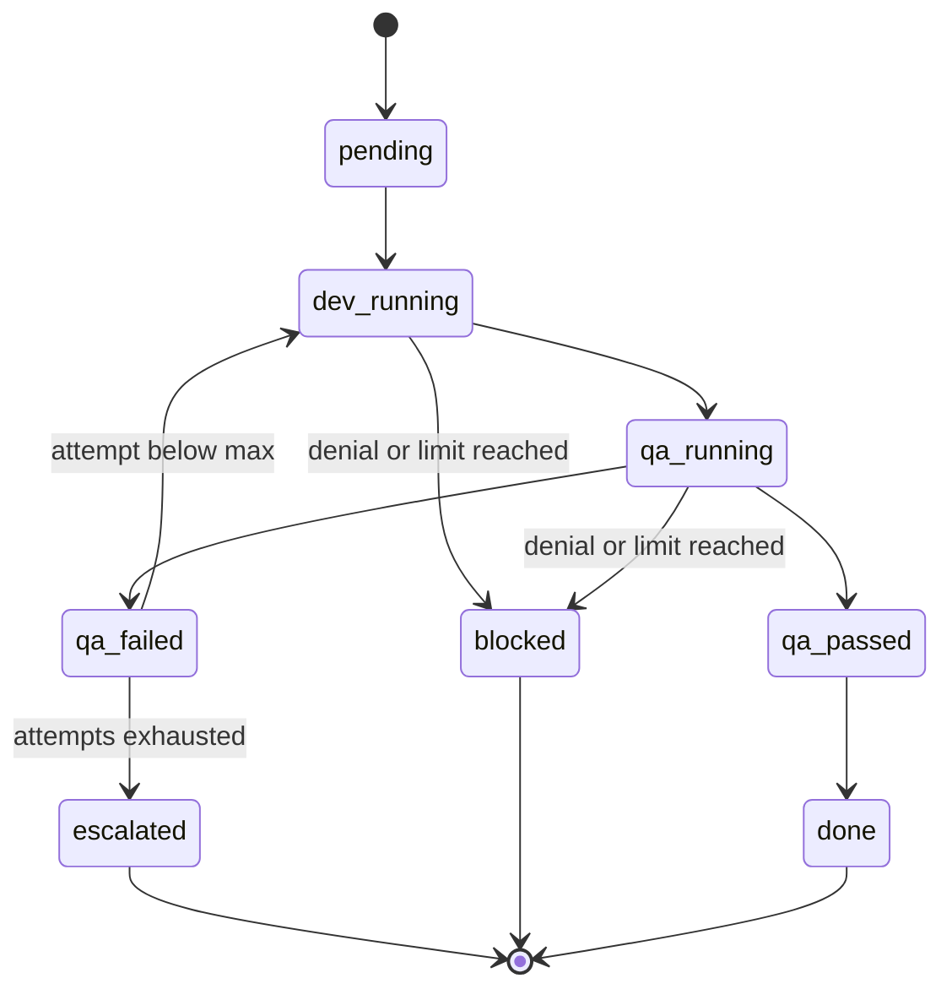
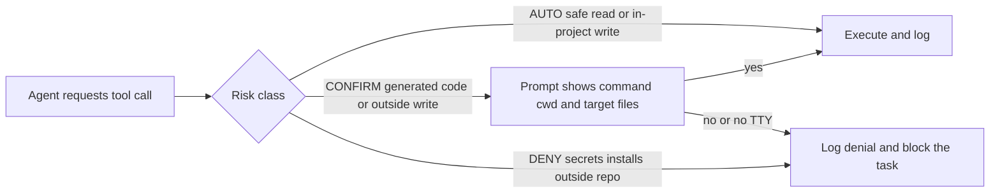
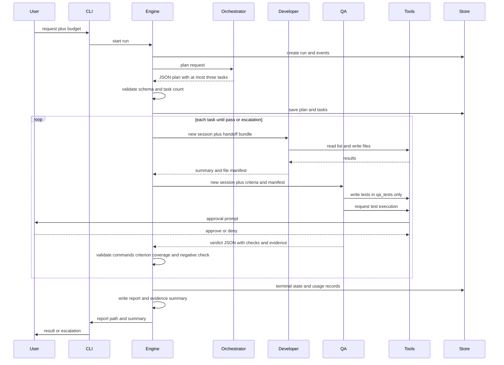

# Phase 1 Architecture and Implementation Plan

**Project:** Generic AI Engineering Team
**Scope:** Phase 1 = minimal but complete end-to-end system
**Status:** Phase 1 in progress; Phase 1 is not accepted. Milestone status, evidence and acceptance are recorded in the milestone contract table and checklist below; the current position is in [`PROJECT_STATE.md`](../PROJECT_STATE.md).
**Revision:** 5 approved text retained. Revision 6 C1–C7 are consolidated in Appendix A: C2 and C3 are approved rules; C1 and C4–C7 remain proposed baseline defaults. Revision 7 (documentation clarity) is `PROPOSAL — HUMAN APPROVAL REQUIRED`.
**Companion documents:** [`AI_Engineering_Team.md`](../AI_Engineering_Team.md)

**Relationship to the charter:** This plan implements one minimal Phase 1 slice of the canonical charter. Where the two documents disagree, the charter is authoritative and this plan is corrected. The charter's indicative Phase 1 to Phase 3 capabilities are delivered here as a single Phase 1 vertical slice; later charter phases remain future direction.

---

## Revision Notes

Revision 5 text is approved. Revision 6 clarifications C1–C7 are consolidated in Appendix A: C2 and C3 are approved rules, while C1 and C4–C7 remain proposed baseline defaults. Revision 7 (documentation clarity and consistency) is `PROPOSAL — HUMAN APPROVAL REQUIRED`. The detailed change list for revisions 2–6 is preserved in git history and is not repeated here.

---

## Scope Statement

Phase 1 delivers one working vertical slice of a generic AI engineering team:

- Chief of Staff / Orchestrator
- Independent Developer Agent
- Independent QA Agent
- Python Workflow Engine that owns state, routing, retries and limits
- Basic Cost Manager with budgets
- Human approval gate for sensitive operations

The Independent Consultant / Reviewer, the Gardening Agent and controlled self-improvement are long-term directions in the charter. They are not Phase 1 roles and are not part of this plan's scope.

The Snake Game is the first end-to-end fixture only. Nothing in the architecture may depend on Snake, on game development, or on Unreal Engine. The same engine must later host unrelated specialists without structural change.

Hard constraints:

1. Developer and QA are genuinely separate agent sessions with separate contexts, prompts, tool sets and transcripts.
2. The Workflow Engine owns task state and execution flow deterministically.
3. QA executes tests itself and produces evidence that the engine validates against the tool audit log.
4. Deterministic execution limits — task count, turns per session and LLM calls per task — exist from the first executable milestone. Token accounting, USD pricing and budget enforcement arrive at M3, when they can be tested against real usage data.
5. The model provider is replaceable behind a narrow interface.
6. No API keys in source, Git, transcripts, prompts or child processes. Only the trusted engine reads them.
7. Small Python implementation, no agent framework.
8. Zoo Code modes are development tooling, not runtime agents.
9. No agent, including the Orchestrator, can change or weaken security rules, approval requirements, budget limits, verification standards, its own permissions or the policy that governs it. Policy is human-owned.
10. The Developer Agent has read, write and list tools only. It has no shell or command execution in Phase 1. QA is the only role that runs commands.
11. Every acceptance criterion has an ID. QA must map each ID to at least one named check, and the Snake fixture must include at least one negative check.

Deferred to later phases: Independent Consultant / Reviewer, Gardening Agent, controlled self-improvement, Git worktree isolation, OS-level process or container isolation, resumable approvals, complex permission systems, parallel execution, mobile and voice control, SQLite, dashboards.

---

## A. Proposed Architecture and Responsibilities

### A.1 Layering principle

Control flow lives in exactly one place: the Python Workflow Engine. AI is used only where judgement is required, namely planning, implementing and verifying. State, routing, retry counting, budgets, permissions and evidence checking are deterministic code.

The strongest structural rule:

> The only channel between two agents is a serialized handoff bundle produced by the engine. No agent ever sees another agent's conversation.

### A.2 Security posture, stated plainly

This section exists so that no later reader overestimates Phase 1.

- Phase 1 runs every agent in the **same Python process, under the same Windows user account**, as the engine. There is no operating system sandbox, no container, no virtual machine and no reduced-privilege account.
- Filesystem path checks are a **guardrail against mistakes**, not a security boundary. They reject `..` traversal, absolute paths outside allowed roots and `.env` access. They cannot stop code that has already run.
- **All execution of agent-generated code requires a separate, explicit human approval for that specific execution.** This includes `python file.py`, `python -m pytest`, and any command that imports or evaluates generated code. Approval prompts show the exact command, the working directory and the files that will be executed. There is no batch, session-wide or run-wide approval.
- **Only QA executes commands in Phase 1.** The Developer Agent is limited to read, write and list, so it cannot run the code it writes. This removes one whole class of prompts and keeps the execution surface to a single role.
- **Secret access is asymmetric by design.** The trusted Workflow Engine may read `.env` or the configured environment variable to build the provider client. Agent tools, handoff bundles, prompts and transcripts never receive secret values. Child processes never inherit or receive secrets.
- Child processes are launched with a **scrubbed environment allowlist**. API keys and other secrets are never inherited and never passed as arguments.
- **No automatic package installation.** Installation requests are denied in Phase 1 and reported to the user as a manual action.
- The QA evidence cross-check protects against fabricated or sloppy reporting. It is an integrity control, not a security control.
- Agent session separation is **logical, not physical**. Separate message lists and transcripts prevent context contamination. They do not prevent one agent's code from affecting the machine.

Consequence for acceptance testing: the first live end-to-end run is performed with a small budget, on a repository the user controls, with approvals visible in the console.

### A.3 Components

| Component | Owns | Explicitly must not do |
|---|---|---|
| CLI `aiteam/cli.py` | One command: `run`, with `--project`, `--request`, `--budget`, `--plan-only`, `--fake` | Contain workflow logic |
| Workflow Engine `aiteam/engine/workflow.py` | Task and run states, routing, retry counting, execution limits, budget stops, escalation, finalization | Call the model directly or edit project files |
| Policy `aiteam/engine/policy.py` | Role permission matrix, exact-command allowlist, risk classification, approval prompt, child environment scrubbing | Pretend to be an OS sandbox |
| Handoff Builder `aiteam/engine/handoff.py` | Bounded, role-specific context bundles built from state | Pass raw transcripts |
| Agent Session `aiteam/agents/base.py` | One throwaway conversation per run, task, attempt and role: prompt, message list, tool loop, turn cap, transcript | Share memory with another agent |
| Role definitions `aiteam/agents/roles.py` plus `agents/prompts/` | Role instructions, allowed tools, model selector, output schema. Developer: read, write, list. QA: read, list, write under `qa_tests/`, run commands. | Decide retries or task state |
| Tool Layer `aiteam/tools/filesystem.py`, `shell.py` | Path-contained file operations for all roles; command execution for QA only, with timeout, output cap and scrubbed environment | Trust model-supplied paths |
| Provider Adapter `aiteam/providers/` | Narrow protocol: neutral messages, tool specs, usage. OpenAI implementation plus a fake provider that returns simulated usage. | Leak into engine logic, or expose credentials to agents |
| Cost Manager `aiteam/cost/manager.py` | Usage records, USD from configured pricing, pre-call budget checks, hard stops | Hardcode provider prices |
| State Store `aiteam/state/store.py` | `index.json` snapshot plus append-only `events.jsonl`, `usage.jsonl`, `approvals.jsonl`, session transcripts | Provide a general event-sourcing framework |
| Reporting, part of `engine/workflow.py` | Markdown run report, QA evidence summary and QA test file list under `runs/<run_id>/` | Be authored by an agent |
| Project Workspace `projects/<slug>/` | Generated artifacts under test | Be edited by the Orchestrator |

### A.4 Agent identity versus agent session

An agent identity persists on disk:

- role name and system prompt file
- tool permission set
- model selector
- archived transcripts

A session is created fresh for each unit of work:

- new `session_id`
- new message list
- new transcript file
- explicit attempt number
- a handoff bundle as its only input
- no inherited conversation and no shared message objects

Phase 1 implements this with separate Python objects and separate transcript files. It does not use separate processes. Separate processes, worktrees or containers are Phase 4 concerns listed in section G.

### A.5 Component diagram

The component diagram is recorded once in [`plans/adr-001-hybrid-architecture.md`](adr-001-hybrid-architecture.md), which is the architecture decision record. The component list in A.3 is the authoritative description in this plan.

### A.6 State model

Task states:

- `pending`
- `dev_running`
- `qa_running`
- `qa_passed`
- `qa_failed`
- `blocked`
- `escalated`
- `done`

Run states:

- `planning`
- `executing`
- `verifying`
- `completed`
- `blocked`
- `escalated`



Approvals are handled synchronously inside the tool call, so there is no `awaiting_approval` state and no resume machinery. A denial moves the task directly to `blocked`, which is the honest outcome for a non-interactive run.

A Developer-stage exception that is not `BudgetError` or `LimitExceeded` uses the existing `dev_running → blocked` transition. It is recorded as `developer_stage_failure_unclassified: <safe error>`; this is stage attribution only and does not assert Developer-code fault or a ProviderError cause. No new state or transition is introduced.

The engine is a loop over a pure function `next_action(run, tasks) -> Action`, plus deterministic handlers. Purity makes every routing rule testable offline with a fake provider.

Actions:

- `orchestrate_plan`
- `run_developer`
- `run_qa`
- `retry_task`
- `escalate`
- `finalize`
- `abort_budget`

### A.7 Independent verification

QA is not trusted; QA evidence is validated by the engine.

1. QA receives a fresh session. It never receives the Developer transcript. It receives the user request, the task acceptance criteria with their IDs, the file manifest with hashes and the previous QA verdict when retrying.
2. QA writes tests only inside `projects/<slug>/qa_tests/`. Every other write path is refused by the tool layer.
3. QA runs verification commands itself. Each execution is a CONFIRM action and therefore approved by the human.
4. QA must return verdict JSON. Every check names the acceptance criterion it covers and whether it is a positive or negative check:

```json
{
  "verdict": "pass",
  "summary": "short explanation",
  "checks": [
    {
      "criterion": "C1",
      "name": "wall collision kills the snake",
      "kind": "negative",
      "command": "python -m pytest qa_tests -q",
      "exit_code": 0,
      "evidence": "captured output excerpt"
    }
  ],
  "unverified_requirements": []
}
```

5. The engine cross-checks every `checks[].command` and `exit_code` against the QA session's actual tool audit log. Any mismatch, zero executed commands, or empty `checks` downgrades the verdict to `fail` with an engine-attributed reason.
6. The engine checks criterion coverage. Every acceptance criterion ID must appear in at least one check, and at least one check must have `kind` set to `negative`. A missing criterion or a missing negative check is a failure with a named reason.
7. **The engine writes every report file**, including the QA evidence summary inside `runs/<run_id>/report.md`, and lists the QA test files so the user can perform the required spot check. QA writes no report files at all.

### A.8 Permissions and human approval

**AUTO** means the action proceeds and is logged:

- reading files inside the active project, except `.env` and other secret files, which are always denied
- Developer writes inside `projects/<slug>/`, excluding `qa_tests/`
- QA writes inside `projects/<slug>/qa_tests/` only
- QA reading a fixed allowlist of informational commands that execute no generated code, matched by exact argument list, for example `git status --short` and `python --version`

**CONFIRM** means the human is asked before execution. In Phase 1 only QA can reach this class:

- any QA command that runs, imports or evaluates generated code, including `python <file>`, `python -m pytest`, and any test runner
- writes outside the active project
- deletions beyond a small threshold
- any QA command not on the informational allowlist

**DENY** means the action is refused and recorded:

- any shell or command execution requested by the Orchestrator or the Developer
- reading or writing `.env` or any secret store through an agent tool; only the trusted engine may read them
- paths outside the repository
- deleting the repository root or `projects/` root
- package installation of any kind, in any form, including `pip`, `conda`, `npm`, `winget` and subprocess-wrapped variants
- privilege escalation attempts

The role matrix is explicit and not self-modifiable: Orchestrator has no file or shell tools; Developer has read, write and list; QA has read, list, write inside `qa_tests/`, and run. No role can grant itself an additional tool.

The allowlist matches complete argument vectors, never prefixes. Matching prefixes would make `python` a universal code-execution grant, which is precisely what must not happen.



Approval prompt rules:

- In Phase 1, only QA can trigger an approval prompt.
- The prompt shows the exact argv, working directory, every file that will be executed, and a warning that the code was produced by an AI and is unreviewed.
- Default and empty input is No.
- Choices are exactly `y` to approve this specific execution and `n` to deny this specific execution. There is no approve-once-for-the-session option, no batch approval, and no session-wide or run-wide flag.
- Every execution of agent-generated code receives its own decision, even when the same command was approved earlier in the same session.
- When stdin is not a TTY, a CONFIRM action is treated as denied and the task becomes `blocked` with a clear message.
- Every decision is appended to `state/approvals.jsonl` with timestamp, run, task, session, argv and decision.

Governance of these rules:

- Policy constants, approval requirements, budget limits and verification standards are human-owned configuration.
- No agent, including the Orchestrator, can modify them, grant itself permissions, or relax a check. A run that needs such a change stops and reports it to the user.
- Phase 1 has no self-modification path at all.

Child environment rules:

- Build the child environment from an allowlist only, for example `PATH`, `PATHEXT`, `SystemRoot`, `WINDIR`, `TEMP`, `TMP`, `COMSPEC`, `USERPROFILE`, `HOMEDRIVE`, `HOMEPATH`, `APPDATA`, `LOCALAPPDATA`, `NUMBER_OF_PROCESSORS`, plus `PYTHONUTF8=1` and `PYTHONIOENCODING=utf-8`.
- Never copy `os.environ` wholesale.
- Never forward variables matching `AITEAM_`, `OPENAI_`, `AZURE_`, `AWS_`, `ANTHROPIC_`, `GITHUB_`, `TOKEN`, `SECRET`, `KEY` or `PASSWORD`.
- Never pass secrets in argv.
- The engine keeps the key in memory only to build the provider client. It is never placed in a child environment, argv, prompt, handoff bundle, transcript or error message.
- Tests assert that the child environment contains none of the configured secret values.

### A.9 Execution limits, cost and budget

Deterministic execution limits and cost accounting are deliberately separate, so limits exist at the first executable milestone without pulling pricing in early.

**Execution limits, from M1**

- `max_tasks_per_plan`, `max_turns_per_session`, `max_llm_calls_per_task`, command timeout and output cap are enforced by the engine and the session runtime.
- `max_attempts` joins these limits at M4, when retry routing exists.
- Counters increment deterministically. Reaching a limit moves the task or run to `blocked` with the breached limit named in the report.
- The fake provider returns simulated usage counts, configurable per scripted response, so every limit is testable without a paid call.

**Cost accounting and budget enforcement, from M3**

- Every provider call emits a `UsageRecord` with run, task, agent, model, input tokens, output tokens and USD. Records are written even when the call fails.
- USD is computed only from the pricing table in `config/aiteam.toml`. An unknown model is a hard configuration error, never a silent zero cost.
- The run budget is checked before each call. Exhaustion moves the task and run to `blocked` with a per-agent cost breakdown in the report.
- Live provider mode validates models and pricing before the first API call, as described in C.1.

Limits are enforced by the engine, never by asking a model to stop.

---

## B. System Flow



### B.1 Narrative of the Snake run

1. User runs `python -m aiteam run --project snake --budget 2.00 --request "Build a playable Snake game"`.
2. The engine creates a run and a project record and appends events.
3. The Orchestrator session, with no file tools, returns a plan of one to three tasks, each with a description, acceptance criteria with stable IDs, and technology constraints. The engine validates the schema, enforces `max_tasks_per_plan = 3` and persists the plan.
4. For each task the engine builds a Developer bundle and starts a fresh Developer session with read, write and list tools inside `projects/snake`. The Developer has no shell tool.
5. The Developer writes files without approval. Because it cannot execute code, no approval prompt originates from the Developer.
6. The engine builds a QA bundle from state only and starts a fresh QA session with read and list access to the project, write access limited to `qa_tests/` and shell access. QA writes its own tests and requests execution; each execution is approved or denied separately.
7. The engine validates the verdict against the audit log, checks that every criterion ID is covered and that at least one negative check exists, then writes the evidence summary and lists the QA test files in the report.
8. Pass leads to `done`. Fail increments the attempt and starts a new Developer session containing the failed checks. Exhaustion leads to `escalated`.
9. The engine writes `runs/<run_id>/report.md` with the plan, attempts, commands and exit codes, evidence, cost per agent, any denial or block reason and the QA test file list.
10. The CLI prints the verdict and report path. The user then performs the required spot check of the QA test files before accepting Phase 1.

### B.2 Context separation

| Handoff | Contains | Excludes |
|---|---|---|
| Orchestrator input | user request, budget, project type hint | any prior agent transcript |
| Developer bundle | request, task description, acceptance criteria, technology constraints, previous QA failed checks, file manifest | QA transcript, QA reasoning, engine internals |
| QA bundle | request, acceptance criteria, file manifest with hashes, previous QA verdict, testing conventions | Developer transcript, Developer claims |
| User report | plan, states, commands and exit codes, evidence, cost, denials and blocks | secrets, full transcripts by default |

---

## C. Repository Layout and Configuration

The repository layout is the implementation and is not duplicated here; the package structure is visible in the repository. New files follow the layering in A.1: the engine owns state, policy and acceptance, agents own prompts and sessions, tools are the only execution surface, and tests mirror the package they cover.

Configuration is deliberately small. Command policy lives in code as constants in `policy.py`; only models, prices and limits are configurable. The authoritative values are in [`config/aiteam.toml`](../config/aiteam.toml); example values are not repeated here because they go stale.

### C.1 Configuration validation

Live provider mode fails before any API call when:

- any role model identifier is empty or contains a placeholder such as `update-me`, `changeme`, `todo`, `your-model-id`, `xxx` or an unfilled angle-bracket token
- any role model lacks a `[pricing."<model>"]` entry
- any pricing value is missing, non-numeric or negative

The engine checks this while loading configuration and again immediately before the first live call. Failure exits with the offending role, model and field, records no usage and makes no request. Fake mode uses `tests/fixtures/aiteam.fake.toml` with `provider.name = "fake"`, fake model identifiers and zero prices, so tests never need real model IDs or real rates. Validation is provider agnostic: no provider- or model-specific rule is embedded in the engine.

Generated project layout for the first fixture. Note that QA writes only `qa_tests/` and no report file:

```text
projects/snake/
├─ game.py            pure game logic, no UI, deterministic and seedable
├─ app.py             thin renderer, tkinter if available
├─ README.md          how to run
└─ qa_tests/          written only by QA, includes at least one negative test
   └─ test_*.py
```

Runtime artefacts:

```text
state/
├─ index.json         authoritative snapshot of projects, tasks, runs, counters
├─ events.jsonl       append-only audit log, never replayed in Phase 1
├─ usage.jsonl        one record per provider call
└─ approvals.jsonl    one record per approval decision

runs/<run_id>/
├─ plan.json
├─ orchestrator.session.jsonl
├─ task-1.developer.a1.session.jsonl
├─ task-1.qa.a1.session.jsonl
└─ report.md          includes the QA evidence summary written by the engine
```

`index.json` is authoritative. `events.jsonl` is an audit and reporting trail only. There is no replay, no reconstruction step and no event-sourcing abstraction in Phase 1.

---

## D. Minimal Dependencies and Rationale

### D.1 Verified and unverified environment

| Item | Status | Action |
|---|---|---|
| Conda environment `ai-team` | Target environment | Use it for everything |
| Python 3.12.16 | Confirmed in `ai-team` | None |
| pip | Confirmed in `ai-team` | None |
| OpenAI SDK | Installed and verified in `ai-team`: SDK 3.57.0 (2026-11-23). The M0 report recorded it missing and deferred it until before M5. | Never installed by an agent. Phase 1 denies installation; re-check only if the environment changes. |
| pytest | Installed and verified in `ai-team`: pytest 9.2.0 (2026-11-23). The M0 report recorded it missing and required it before M1. | Never installed by an agent. Phase 1 denies installation; re-check only if the environment changes. |
| tkinter | Present: Tk 8.6, verified at M0. | None. The Snake fixture must still pass headless. |
| Git repository and initial commit | Already exist | Verify clean tree and current branch |

As of 2026-11-23 all three are present in `ai-team`. If any of them later becomes missing, the agent team reports it and the user installs it in a normal shell; Phase 1 contains no installation path at all.

### D.2 Dependencies

| Dependency | Type | Why it is needed |
|---|---|---|
| `openai` | runtime | Installed and verified in `ai-team`: OpenAI SDK 3.57.0 (2026-11-23). Used by the OpenAI-compatible provider adapter; handles tool schemas, retries and usage reporting. |
| `pytest` | dev | Runs the engine's own tests and is reused as the project test runner for QA, so no second test framework appears. |

The adapter isolates the engine from the SDK. If a different live provider is selected, its SDK replaces `openai` and the pricing table is updated; engine code and configuration keys stay unchanged.

Standard library modules used intentionally:

| Module | Use |
|---|---|
| `argparse` | CLI parsing |
| `tomllib` | Configuration and pricing on Python 3.12 |
| `dataclasses`, `enum`, `uuid` | Domain models and state enumerations |
| `json`, `pathlib`, `hashlib`, `os` | State files, manifests, atomic writes via `os.replace` |
| `subprocess` | Command execution with `shell=False`, argument lists, scrubbed environment and timeouts |
| `logging` | Engine and tool audit trail |
| `datetime` | Event and usage timestamps |

Deliberately excluded:

- **Agent frameworks** such as LangChain, LangGraph, CrewAI, AutoGen or the OpenAI Agents SDK. They own the control flow that must stay in the engine, add large dependency trees and obscure where state and retries live.
- **`pydantic`**. One small validation module with clear messages and a single repair retry.
- **`python-dotenv`**. A small parser inside `config.py`. Real environment variables remain the primary path.
- **`rich`** and **`typer`**. Plain stdout keeps output pipeable.
- **`gitpython`**. No Git automation in Phase 1.
- **Playwright** or **Selenium**. The Snake fixture is stdlib Python, so verification is headless.
- **Any sandboxing library**. Phase 1 does not claim sandboxing, so it must not pretend to implement it.

### D.3 Secret handling

Three distinct access levels:

| Actor | May read `.env` and secret values | Notes |
|---|---|---|
| Trusted Workflow Engine | Yes | Reads the configured environment variable, falling back to `.env` for local development. Holds the value in memory only to build the provider client. |
| Agent tools, Orchestrator, Developer, QA | No | Denied by policy. Handoffs, prompts, transcripts and tool arguments never contain secret values. Agents reach the model only through the provider adapter. |
| Child processes | No | Receive the scrubbed allowlist environment from A.8, with secret-shaped names removed. |

- `.env` is already ignored by `.gitignore`. `.env.example` lists variable names with empty values.
- The logger and transcript writer redact any configured secret value, including inside error messages and tool output.
- Transcripts never include the process environment.
- The engine refuses to start when a required key is missing and warns when a key appears to be committed.

---

## E. Step-by-Step Implementation Roadmap

Guiding rule: no feature is built before the milestone that needs it. The first milestone is a working FakeProvider vertical slice, so the whole loop is demonstrable and testable before any paid call or any generated code execution.

### M0 Environment and repository verification

Confirm the `ai-team` conda environment: Python 3.12.16, pip, `openai`, `pytest`, `tkinter`. Confirm the existing Git repository, branch and clean tree. Extend `.gitignore` for `state/` and `runs/`, ignore `projects/*` and re-include `projects/snake/` so the fixture source, its README and its QA tests stay in Git. Add `.env.example`.

Exit criterion: a short environment report records each item as present or missing. Missing packages are reported as manual user actions. No installation is attempted.

### M1 Walking skeleton with FakeProvider, plan, write and execution limits

Add only: `models.py`, minimal `config.py`, `state/store.py` with the snapshot and events log, `providers/base.py`, `providers/fake.py`, `agents/base.py`, the Orchestrator and Developer prompts, `engine/handoff.py` in minimal form, `engine/workflow.py` covering plan and Developer stages, `cli.py run`, and report writing.

The Developer role is created with read, write and list tools only. Includes deterministic execution limits from the start: task count per plan, turns per session and LLM calls per task, with counters enforced by the engine and the session runtime. The fake provider returns simulated usage counts so the counters are testable without a paid call.

Not yet: QA, command execution, usage records, token accounting, USD pricing, budget enforcement, retries.

Exit criterion: one `python -m aiteam run --fake ...` with a scripted plan creates tasks, writes a file inside `projects/demo/`, emits the event log, writes `runs/<id>/report.md`, and the execution-limits assertions pass, with each cap stopping the run and naming the breached limit. The Developer registers no shell tool.

### M2 QA execution, evidence mapping and approval

Add only: `tools/shell.py` for QA with the scrubbed environment and timeout, exact-argument informational allowlist, CONFIRM prompts for generated code, `qa_tests/` write restriction, the QA role and prompt, criterion ID handoff, QA verdict JSON with `criterion` and `kind`, the engine's audit-log and coverage checks, the approvals log, and denial leading to `blocked`.

Exit criterion: the success, approval-granted, approval-denial, missing-criterion and missing-negative-check scenarios pass against the fake provider. Every QA execution prompts separately. `test_policy.py` proves that `pip install`, `.env` access and any Developer or Orchestrator shell request are denied, while secret values never reach the child environment.

### M3 Cost accounting and budget enforcement

Add only: `cost/manager.py`, usage records written to `state/usage.jsonl`, token accounting, USD pricing from `config/aiteam.toml`, the run budget check before each call, per-agent cost aggregation, and the live-mode model and pricing validation from C.1.

Exit criterion: the budget-stop scenario passes and the report shows tokens and cost per agent. `tests/test_config_cost.py` proves that placeholder models, missing pricing entries and negative prices are rejected before any call.

### M4 Retry and escalation

Add only: `qa_failed` routing, failure feedback in the Developer bundle, attempt counting and `escalated` when attempts are exhausted.

M4 retry and failure semantics are consolidated in **Appendix A — M4 Design Baseline (C1–C7)**. C2 and C3 are approved rules; C1 and C4–C7 are proposed baseline defaults. This section records scope only and adds no runtime behaviour by itself.

Exit criterion: the retry-then-pass and retry-exhausted scenarios pass as separate runs.

Current status: implemented, independently reviewed and merged into `main` at `9c11b6a` (branch head `432a776`; review fixes `78d6e9c` and `432a776`). An engine-confirmed QA failure with verified non-zero execution evidence retries once; exhausted attempts escalate. `qa_failed_no_retry_in_m2` no longer exists in the engine. Evidence: `tests/scenarios/test_retry_then_pass.py`, `tests/scenarios/test_retry_exhausted.py`, `tests/test_m4_retry.py`. This status and evidence wording was recorded in documentation commit `85d6c90`.

### M5 Live provider validation

Add only: wiring for the selected provider's adapter (currently DeepSeek through the OpenAI-compatible SDK adapter, as recorded in the charter and `config/aiteam.toml`), with a tiny budget and one small task. Keys come from the environment or `.env`, read only by the engine. Every QA execution is approved separately. QA may use the same model as the Developer; per-role model configuration remains available but is not required.

Exit criterion: live mode refuses to start with placeholder models or invalid pricing, usage and cost are recorded, redaction is verified in the transcript and log, and the per-execution QA approval prompt is observed.

### M6 Snake specification and QA test plan

Write the requirement, the pure-logic interface, the deterministic headless mode and the exact QA test list. Each acceptance criterion gets a stable ID such as `C1`. The plan must include at least one negative test. The Developer writes `game.py`, `app.py` and `README.md`. QA writes only `qa_tests/`.

Exit criterion: a human can read the specification, match every criterion ID to at least one planned check, and identify the negative case.

### M7 Snake live end-to-end success run

Run the real flow for the happy path. Retry, budget-stop and denial paths are already proven by dedicated fake-provider scenarios and are not re-proven on a paid run.

Exit criterion: the live criteria in section F are satisfied, `runs/<run_id>/report.md` is published, and the user has completed the QA test file spot check. Phase 1 is not accepted until that spot check is recorded.

### M8 Documentation and progress

Update `AI_Engineering_Team.md` progress and environment tables, and the plan checklist, only after M7 is complete. Write `plans/phase1-backlog.md` with the deferred items in section G.

M0 through M8 are sequential: each milestone begins only after the previous one is completed and recorded. M5 is next, then M6, then M7, then M8. M7 requires completed M5 and M6. M8 runs only after M7 is complete and accepted.

### After Phase 1 — architecture comparison

Once the Snake run is accepted, compare the three-role pipeline with a two-role pipeline: Developer plus Independent QA, no Orchestrator. Use the recorded run data: cost, number of attempts, defects found by QA, defects missed and human interventions. This is an evaluation of the same system, not new Phase 1 scope, and it changes no code by itself. Record the result in `plans/phase1-backlog.md`.

---

## F. Acceptance Criteria for the First Snake End-to-End Test

### F.1 Scenario separation

Each scenario is a distinct test run with its own fake script, its own temporary state directory and its own assertions. Scenarios are never combined inside one run.

| Scenario | Provider | Proves |
|---|---|---|
| Success | Fake | Plan, Developer write, QA execution with criterion mapping, validated evidence, `done` |
| Developer tool restriction | Fake | A Developer or Orchestrator shell request is refused with no approval prompt |
| Execution limits | Fake | Turn cap, LLM call cap and task cap each stop the run deterministically |
| Criterion mapping missing | Fake | The engine rejects a verdict that leaves any criterion ID unchecked |
| Negative check missing | Fake | The engine rejects a verdict without a check marked `negative` |
| Retry then pass | Fake | Failure feedback reaches a new Developer session, final verdict `done` |
| Retry exhausted | Fake | Attempt cap respected, terminal state `escalated`, no loop |
| Budget stop | Fake | Stop before exceeding the budget, terminal state `blocked`, cost detail present |
| Approval denied | Fake | CONFIRM denial produces `blocked` with a recorded denial and no execution |
| Approval granted | Fake | A recorded approval allows that one execution to proceed and the run to continue |
| Snake success | Live | Real model behaviour and real cost on the first fixture |

### F.2 Workflow criteria

1. One command starts a run and it completes without manual intervention except per-execution CONFIRM approvals.
2. Orchestrator output is schema-valid: between one and three tasks, non-empty acceptance criteria per task, each criterion with a stable ID. The limit `max_tasks_per_plan = 3` is enforced and asserted in tests.
3. Deterministic execution limits work from M1 onward: the turn cap, the LLM call cap per task and the task cap each block the run with the breached limit named, using simulated usage from the fake provider.
4. Developer and QA ran as separate sessions with different session identifiers, different transcript files and a recorded attempt number.
5. The Developer role had read, write and list tools only. No shell tool was registered, and no Developer or Orchestrator command reached the tool layer.
6. The QA handoff and transcript contain no Developer transcript content, and QA writes were confined to `qa_tests/`.
7. QA executed at least one verification command, every reported check matches a command and exit code in the audit log, and the engine performed and logged the cross-check.
8. Every acceptance criterion ID appears in at least one check, at least one check is marked `negative`, and the engine logged both validations.
9. The QA verdict is `pass`. `runs/<run_id>/report.md` contains the plan, the evidence summary, unverified requirements, tokens and cost per agent and total, and the list of QA test files.
10. Retry behaviour is proven by the retry-then-pass run and the retry-exhausted run.
11. Budget behaviour is proven by the budget-stop run, which fails on cost only, not on the deterministic limits already covered by the execution-limits run.
12. Approval behaviour is proven by the approval-denied and approval-granted runs. The granted run shows one decision per execution, with no session-wide or run-wide approval.
13. The human QA test file spot check is recorded as completed for the accepted Snake run.
14. State integrity: `state/index.json` agrees with the run report, and `events.jsonl` contains every transition in order with no gaps.

### F.3 Functional Snake criteria

Verified by QA's own tests, not by claims.

15. Initial state: snake length at least three, fully inside the grid, food placed on a free cell.
16. Movement: each tick advances the head one cell in the current direction.
17. Growth: eating food increases length by one and score by one, and respawns food off the body.
18. Wall collision ends the game with a `game_over` state.
19. Self-collision ends the game when the head enters a body cell.
20. Direction reversal into the immediate neck is rejected.
21. The QA suite contains at least one negative test. It asserts that an invalid operation is rejected, and the verdict marks that check as `negative`.
22. Headless mode is deterministic. The same seed and input sequence produce the same state trace, and a five hundred tick simulation completes without exceptions.
23. `app.py` imports cleanly only if its optional renderer dependency is available. tkinter is not required for acceptance, and the UI remains a human spot check.

### F.4 Safety criteria

24. No key, token or secret appears in Git, `state/`, `runs/`, reports, transcripts or child environments. Only the engine reads the configured secret.
25. Every command executed by QA is logged with argv, working directory, exit code, approval decision and truncated output.
26. No agent wrote outside its permitted paths. No QA command ran without its own recorded approval. The Developer made no execution request. No installation was attempted or permitted.

---

## G. Risks and Design Decisions

| # | Decision | Phase 1 choice | Risk if wrong | Revisit trigger |
|---|---|---|---|---|
| 1 | Isolation level | In-process sessions, separate contexts and transcripts. Explicitly not OS isolation. | A misbehaving model runs with full user privileges. Mitigated because only QA can execute, and every QA execution is approved; the Developer has no shell. | Any need for unattended or parallel work, or execution of untrusted code |
| 2 | Path checks | Framed and implemented as guardrails against mistakes | Someone may later treat them as a security boundary | Any proposal to run without approval |
| 3 | Executing generated code | QA is the only role allowed to execute. Every QA execution is CONFIRM, showing command, cwd and target files. `y` or `n` only, one decision per execution. Non-TTY means deny. | Frequent prompts slow the loop; a user who reflexively approves weakens the control | Prompt fatigue observed in practice |
| 4 | Package installation | Denied in Phase 1, reported as a manual user action | A task may be impossible without a dependency; the run ends `blocked` with a clear reason | First project that genuinely needs a third-party package |
| 5 | QA independence | Fresh session, engine-validated evidence, `qa_tests/`-only writes, criterion-to-check mapping, at least one negative check, human spot check | QA may still write shallow tests; mapping and a negative check raise the floor, and the spot check catches obvious padding | Recurring bugs in QA-passed work |
| 6 | Report authorship | Engine writes all reports. QA writes no report files. | Evidence summaries are less rich than a model-written narrative | Reports judged insufficient |
| 7 | State persistence | Authoritative `index.json` plus append-only audit logs. No replay. | Snapshot corruption loses state; audit log is not a recovery mechanism | Concurrency or recovery requirements appear |
| 8 | Approval resumability | Synchronous prompts, no persisted pending approvals, no resume command | An interrupted run must be restarted | Unattended or long-running operation |
| 9 | Plan size | `max_tasks_per_plan = 3`, enforced and tested | Over-decomposition would raise cost and QA complexity | Larger projects need more tasks |
| 10 | Retry semantics | Only QA verdicts and deterministically classified hard Developer errors consume attempts. `max_attempts = 2` is the total attempt allocation; `task.attempt` starts at 1 and increments only when a retry starts. In M4, only an engine-confirmed `QA_FAILED` may trigger an automatic retry. Approval denial, `BudgetError` and `LimitExceeded` do not trigger a retry and do not consume an attempt. No deterministic hard-Developer-error classifier exists, and M4 does not introduce one. Any other Developer-stage exception is recorded as `developer_stage_failure_unclassified`: stage attribution only, not Developer-code fault, and not a ProviderError claim. It stops in the existing `blocked` state, does not retry and does not consume an attempt. Existing Cost Guard settlement/uncertain accounting remains unchanged. Infrastructure errors consume budget, not attempts. | Misattribution could loop or escalate early | Observed misclassification |
| 11 | Provider strategy | Tool-calling capable models only. Strict JSON validation with one repair retry. | A provider without native tool calls cannot be used | Adding such a provider |
| 12 | Pricing source | Static per-million-token table. Placeholder models, missing pricing entries and negative prices fail live mode before any call. | Reported USD drifts from real billing, or a live run starts with no valid price | Any billing-relevant decision |
| 13 | Snake technology | Pure logic in `game.py`, optional tkinter shell in `app.py`, deterministic headless mode | tkinter may be absent; accepted because it is not required for acceptance | If a real UI is required as a gate |
| 14 | Generated work location | `projects/<slug>/`; only `projects/snake/` is tracked in Phase 1, other slugs stay git ignored; runtime `state/` and `runs/` are always ignored | Generated code outside the Snake fixture has no version history | First time a rollback is needed |
| 15 | Git strategy | Human-driven commits only. `git status` allowed as an informational command. | Generated work is not isolated or attributable | Phase 4 worktrees and branches |
| 16 | Context growth | Turn caps, tool output truncation, handoff size caps, never passing transcripts | Agents starve for context and produce weaker work | Agents failing for missing information |
| 17 | Developer tool restriction | Read, write and list only. No shell. | The Developer cannot reproduce a failure by running it; debugging shifts to QA evidence and the next attempt. | Repeated cases where the Developer cannot proceed without execution |
| 18 | QA model choice | Phase 1 may use the same model for Developer and QA. Per-role configuration stays available. | Same-model QA shares blind spots. Mitigated by criterion mapping, a required negative check and the human spot check. | QA misses a defect that a different model would catch |

### G.1 Phase 1 essentials versus deferred

| Phase 1 essential | Deferred |
|---|---|
| Deterministic engine with explicit states, retry counting and escalation | Parallel tasks and multi-run scheduling |
| Three roles with separate sessions, prompts, tool sets and transcripts | Researcher, Environment Manager, Gardening, Independent Consultant / Reviewer and other specialists; Developer shell execution only if a future review justifies it |
| QA-only command execution, exact-command allowlist, CONFIRM for QA runs, DENY for installs and secrets | Full permission policy language, signed approvals, OS sandbox, containers, worktrees |
| QA criterion mapping, required negative check and human spot check | Mutation testing, coverage tooling, multi-model QA |
| Scrubbed child environment | Secret brokers or per-agent credential scopes |
| Token and USD tracking with hard stops | Cost forecasting, provider routing, dashboards |
| Snapshot state plus audit logs | SQLite, event replay, recovery tooling |
| Interactive approval, non-TTY deny | Resumable approvals, `approve` and `resume` commands, remote approval |
| Policy and limits owned by the human | Controlled self-improvement, evaluation and rollback, and any agent-proposed change to its own rules |
| CLI plus markdown report | Web interface, mobile and voice control |
| Snake as the end-to-end fixture | Unreal Engine tooling and other production projects |

### G.2 Remaining decisions before implementation

Status labels are evidence-based. `RESOLVED` items have an approved record or a configured value; `OPEN` items still need a Human decision. This list records status only and does not promote proposed revision 7.

1. **RESOLVED.** Provider identity, model identifiers and pricing entries: `config/aiteam.toml` sets provider `deepseek` with an explicit endpoint, model `deepseek-flash` for all three roles, and a `[pricing."deepseek-flash"]` entry; placeholders and invalid pricing are rejected in live mode. Evidence: charter §7 "Decided and no longer open", `config/aiteam.toml`.
2. **RESOLVED after M0.** The M0 environment report (2026-11-20) recorded `openai` and `pytest` as **missing** and `tkinter` as present, and deferred the OpenAI SDK until before M5. The OpenAI SDK 3.57.0 and pytest 9.2.0 were installed and verified afterwards in the `ai-team` environment (charter §6, 2026-11-23). The M0 findings are historical evidence; the later verified state is the current one. Evidence: `records/m0-environment-report.md` and `AI_Engineering_Team.md` §6.
3. **PARTLY RESOLVED.** Model choice is configured in `config/aiteam.toml`. The run budget for the single live Snake run remains a Human decision at that run.
4. **OPEN.** Whether project slugs other than the Snake fixture should stay git ignored after Phase 1. The Snake fixture is tracked in Phase 1. Recommendation: keep other slugs ignored until Git isolation exists.
5. **RESOLVED.** Initial live provider identity: the provider is DeepSeek through the OpenAI-compatible adapter (charter §7). The adapter and pricing table still isolate the engine from that choice.
6. **Not an open decision.** The three-role versus two-role comparison metrics are defined after the Snake run, using its recorded data. No code changes are implied.
7. **PARTLY RESOLVED.** QA uses the same model as the Developer in Phase 1 and no second provider is required (`config/aiteam.toml`). Whether to assign different models or a second provider per role, and how to compare cost, speed and quality, remains open in the charter.

M5 prerequisites and M5 acceptance are separate requirements. M5 execution needs only the adapter wiring for the selected provider, valid model identifiers and pricing in `config/aiteam.toml`, and a run budget that the Human decides for that M5 run, as item 3 above records. M5 acceptance is the section E exit criterion together with the live criteria in section F, and it is recorded separately. No existing requirement makes M1–M3 retroactive closeout artefacts a prerequisite for starting M5.

---

## Phase 1 Implementation Checklist

Status legend: `[x]` = completion criteria evidenced; `[ ]` = not evidenced. The status text is authoritative; a tick never implies formal closeout or Human acceptance by itself.

- [x] M0 Verify `ai-team` environment and repository, extend `.gitignore`, add `.env.example`, record missing packages as manual actions — completed; `records/m0-environment-report.md` records PASS
- [ ] M1 Build the FakeProvider walking skeleton: models, minimal config, snapshot store, agent session, plan and Developer write stages with read, write and list tools only, execution limits and report — implementation present; formal closeout `UNVERIFIED`
- [ ] M2 Add QA-only execution with scrubbed environment, per-execution CONFIRM approval prompts, `qa_tests/` restriction, criterion coverage, negative check validation and denial handling — implementation present; formal closeout `UNVERIFIED`
- [ ] M3 Add cost accounting: usage records, token accounting, USD pricing, budget enforcement and live-mode configuration validation — implementation present; formal closeout `UNVERIFIED`
- [x] M4 Add retry, failure feedback and escalation — implementation completed, independently reviewed and merged into `main` at `9c11b6a`
- [ ] M5 Validate the live provider adapter on one small task with a tiny budget, rejected placeholders and per-execution QA approvals — diagnostic executed; formal acceptance and closeout not recorded
- [ ] M6 Write the Snake specification with criterion IDs and a QA test plan that includes a negative test — not started
- [ ] M7 Run the live Snake end-to-end success case, verify acceptance criteria and complete the human QA test file spot check — not started
- [ ] M8 Update progress documentation only after M7, record the three-role versus two-role comparison plan and the deferred backlog — not started

### Milestone contract table

This table states the same requirements already defined in sections E–F. It adds no new requirement; it makes the existing contract explicit.

| Milestone | Objective | Scope | Dependencies | Completion criteria | Required evidence | Human acceptance |
|---|---|---|---|---|---|---|
| M0 | Verify the environment and repository | Environment checks, `.gitignore`, `.env.example` | None | Every item recorded present or missing; no installation attempted | `records/m0-environment-report.md` | Report accepted; no separate sign-off recorded |
| M1 | FakeProvider vertical slice | Models, config, store, agent session, plan, Developer write, limits, report | M0 | One fake run creates tasks, writes a file, writes a report, limits asserted | Test run and report | Not recorded (`UNVERIFIED`) |
| M2 | QA execution and evidence | QA shell tool, approval prompts, `qa_tests/` restriction, coverage and negative-check validation | M1 | Five M2 scenarios pass; policy denials proven | Scenario tests and approvals log | Not recorded (`UNVERIFIED`) |
| M3 | Cost and budget | Usage records, pricing, budget stop, live-mode config validation | M2 | Budget-stop scenario passes; invalid pricing rejected | Tests, `usage.jsonl`, report | Not recorded (`UNVERIFIED`) |
| M4 | Retry and escalation | `qa_failed` routing, failure feedback, attempt counting, escalation | M3 | Retry-then-pass and retry-exhausted pass as separate runs | Scenario tests and `tests/test_m4_retry.py`; merged at `9c11b6a` | Merge approved by the Human 2026-11-24 |
| M5 | Live provider validation | Adapter wiring, tiny budget, per-execution approval | M4 | Placeholder models and invalid pricing refused; usage and cost recorded; redaction verified; approval prompt observed | Run artefacts and report | Not recorded; formal acceptance outstanding |
| M6 | Snake specification | Requirement, criterion IDs, headless mode, QA test plan with a negative test | M5 | Every criterion ID maps to at least one planned check; negative case identifiable | Specification document | Human review of the specification |
| M7 | Snake live end-to-end run | Happy path on the live provider plus human spot check | Completed M5 and M6 | Section F criteria satisfied; report published | `runs/<run_id>/report.md` and recorded spot check | Required — Phase 1 acceptance depends on it |
| M8 | Documentation and progress | Charter and plan updates, `plans/phase1-backlog.md` | M7 | Progress recorded; backlog written; archived documents untouched | Updated documents | Not started |

### Appendix A — M4 Design Baseline (C1–C7)

This appendix consolidates the Revision 6 clarifications into one narrow M4 design baseline. It records the agreed semantics, not a task list: M4 implementation is completed, reviewed and merged into `main` at `9c11b6a`, and this appendix stays the reference for those semantics. C2 and C3 are approved rules. C1 and C4–C7 are proposed baseline defaults and remain subject to Human approval. The baseline is intentionally testable and revisable after real-world use.

#### M4.1 Attempt allocation and counter increment (C1 — proposed)

**Status:** `PROPOSED BASELINE DEFAULT — HUMAN APPROVAL REQUIRED`

`max_attempts` is the total number of attempts for a task, not the number of retries. A task starts with `task.attempt = 1`. The counter increments only when a retry actually starts, never when a failure is first recorded. Attempt allocation, attempt consumption and counter increment are separate:

- allocation = total attempts allowed;
- consumption = an attempt counts toward the retry cap;
- increment = `task.attempt` increases by one only when a retry starts.

Consumption by failure type, consistent with the approved C2/C3 wording:

- engine-confirmed `QA_FAILED`: consumes the attempt and may trigger a retry;
- deterministically classified hard Developer error: consumes the attempt but does not trigger an automatic retry in M4;
- unclassified Developer-stage exception: does not consume an attempt;
- approval denial, `BudgetError` and `LimitExceeded`: do not consume an attempt.

Consumption and increment are independent: consuming an attempt does not itself increment `task.attempt`; the counter increments only when a retry actually starts. These are the only consumption rules recorded here; no additional consumption rule is introduced.

Approved C2/C3 wording already states these semantics. That approval applies only as part of C2/C3; C1 itself remains a proposed baseline default.

#### M4.2 Retry eligibility and Developer-stage failures (C2, C3 — approved)

**Status:** `APPROVED — 2026-11-24`

Only an engine-confirmed `QA_FAILED` may trigger an automatic retry in M4. Approval denial, `BudgetError` and `LimitExceeded` keep their existing terminal handling; none triggers a retry or consumes an attempt. Any other Developer-stage exception is recorded as `developer_stage_failure_unclassified`, with safe diagnostic information. This is stage attribution only; it does not assert Developer-code fault and does not claim a ProviderError cause. It stops in the existing `blocked` state, does not retry and does not consume an attempt. Existing Cost Guard settlement/uncertain accounting remains unchanged. No hard-Developer-error classifier is introduced in M4; deterministically classified hard Developer errors remain a future category. A classified hard Developer error would consume the attempt in which it occurs but would not trigger an automatic retry in M4.

No new state or transition is introduced; A.6 documents the existing `dev_running → blocked` reason mapping.

#### M4.3 Failure feedback (C4 — proposed)

**Status:** `PROPOSED BASELINE DEFAULT — HUMAN APPROVAL REQUIRED`

A retried Developer session receives a bounded failure feedback bundle produced by the engine: the failed checks, the criteria they cover and the engine's failure reasons. A retried QA session receives the previous QA verdict, including its failed checks, together with the engine failure reason. No full transcript, no Developer self-assessment and no unnecessary history are passed to either role.

#### M4.4 LLM call accounting (C5 — proposed)

**Status:** `PROPOSED BASELINE DEFAULT — HUMAN APPROVAL REQUIRED`

`task.llm_calls` stays cumulative across the attempts of the same task and is not reset by a retry. The existing `max_llm_calls_per_task` limit therefore continues to apply for the whole task.

#### M4.5 Engine internal errors (C6 — proposed)

**Status:** `PROPOSED BASELINE DEFAULT — HUMAN APPROVAL REQUIRED`

An engine internal error does not trigger an automatic retry and does not trigger ordinary QA-failure escalation. Existing engine error handling is preserved, together with the relevant evidence. M4 introduces no new workflow state or transition for engine internal errors; the failure is left for human review through the existing handling.

#### M4.6 Baseline documentation scope (C7 — proposed)

**Status:** `PROPOSED BASELINE DEFAULT — HUMAN APPROVAL REQUIRED`

This baseline is documentation only. It does not update the milestone checklist or implementation status. M4 completion must be recorded when M4 is completed and accepted.

#### M4.7 Status summary

| ID | Baseline section | Status | Provenance |
|---|---|---|---|
| C1 | M4.1 | `PROPOSED BASELINE DEFAULT — HUMAN APPROVAL REQUIRED` | Revision 6 C1 |
| C2 | M4.2 | `APPROVED — 2026-11-24` | Revision 6 C2 |
| C3 | M4.2 | `APPROVED — 2026-11-24` | Revision 6 C3 |
| C4 | M4.3 | `PROPOSED BASELINE DEFAULT — HUMAN APPROVAL REQUIRED` | Revision 6 C4 |
| C5 | M4.4 | `PROPOSED BASELINE DEFAULT — HUMAN APPROVAL REQUIRED` | Revision 6 C5 |
| C6 | M4.5 | `PROPOSED BASELINE DEFAULT — HUMAN APPROVAL REQUIRED` | Revision 6 C6 |
| C7 | M4.6 | `PROPOSED BASELINE DEFAULT — HUMAN APPROVAL REQUIRED` | Revision 6 C7 |
